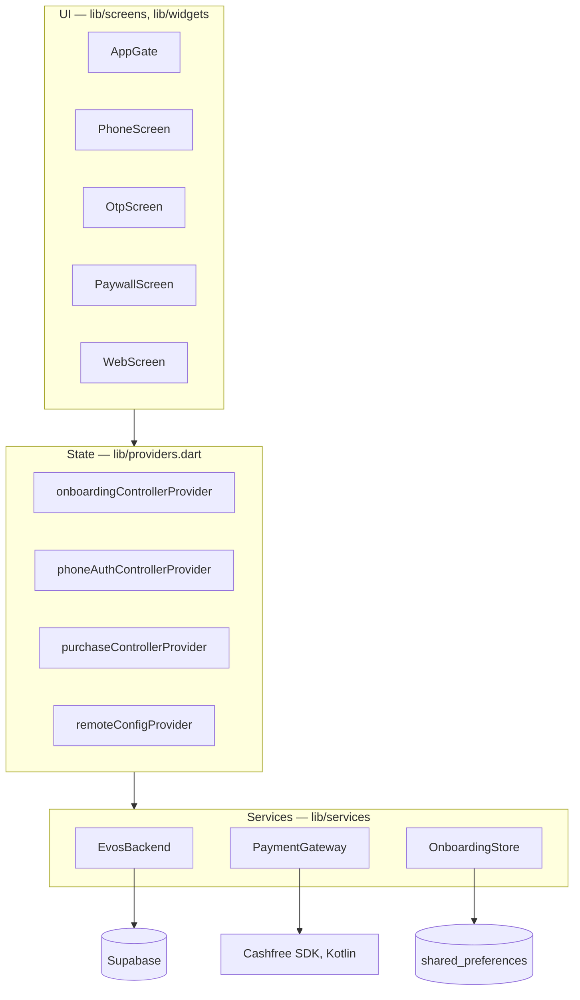
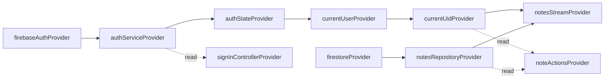

# Architecture

The app has three layers. Widgets read state from Riverpod providers, providers call services, and services are the only code that talks to Supabase, the payment SDK or the device's storage.

Analytics sits beside this: controllers and screens call `Analytics`, which sends to Mixpanel and the Facebook SDK over a method channel. It is described in [10-analytics.md](10-analytics.md).

`AppGate` is the root widget. It shows the mobile-number, code, paywall or web page screen for the stage in `onboardingControllerProvider`; the details are in [09-deep-link-onboarding.md](09-deep-link-onboarding.md). The one exception is the review number 9931133385, which gets the notes screens backed by a device-local store (`LocalNotesStore`). The Firestore-backed notes path, `AuthService` and `NotesRepository` are still in the code but unused since 2026-10-22.

## Folder layout

| Path | Contents |
|------|----------|
| [lib/main.dart](../lib/main.dart) | Entry point: deep-link observer, the `App Opened` and `Install Attributed` events, Firebase initialisation (kept for the unreachable notes code), onboarding store load, `NotesApp`, the bootstrap error screen |
| [lib/firebase_options.dart](../lib/firebase_options.dart) | Hand-written Firebase options for Android and iOS |
| [lib/providers.dart](../lib/providers.dart) | Every Riverpod provider and all six controllers |
| [lib/models/note.dart](../lib/models/note.dart) | The `Note` model and its Firestore mapping |
| [lib/services/auth_service.dart](../lib/services/auth_service.dart) | Firebase auth state and sign-out; unused since 2026-10-22 |
| [lib/services/notes_repository.dart](../lib/services/notes_repository.dart) | Firestore reads and writes for notes; unused since the review account went local |
| [lib/services/local_notes_store.dart](../lib/services/local_notes_store.dart) | `LocalNotesStore`: the review account's device-local notes, persisted through `OnboardingStore` |
| [lib/models/onboarding.dart](../lib/models/onboarding.dart) | `OnboardingState` (stage and review-account flag), `OnboardingStage` |
| [lib/models/review_account.dart](../lib/models/review_account.dart) | The store-review number and its fixed code |
| [lib/models/country.dart](../lib/models/country.dart) | `Country` and the list for the sign-in country selector |
| [lib/models/remote_config.dart](../lib/models/remote_config.dart) | `RemoteConfig`: the backend's name, logo, colour, paywall text, prices and web page URL, with defaults and parsing |
| [lib/models/install_source.dart](../lib/models/install_source.dart) | `InstallSource`: the campaign fields of the Play install referrer, for analytics |
| [lib/services/analytics.dart](../lib/services/analytics.dart) | `Analytics`, one method per event, and the method-channel client behind it |
| [lib/supabase_options.dart](../lib/supabase_options.dart) | Supabase URL and anon key, from `--dart-define` |
| [lib/services/install_referrer_service.dart](../lib/services/install_referrer_service.dart) | Reads the Play Store install referrer, for analytics; referrer marker constants |
| [lib/services/evos_backend.dart](../lib/services/evos_backend.dart) | `EvosBackend`: phone sign-in, settings, subscription status and the payment functions on Supabase, plus the test-mode stand-in |
| [lib/services/deep_link_service.dart](../lib/services/deep_link_service.dart) | Receives deep links, for analytics; link host and path constants |
| [lib/services/onboarding_store.dart](../lib/services/onboarding_store.dart) | The onboarding stage, phone session and last settings, on the device |
| [lib/services/payment_gateway.dart](../lib/services/payment_gateway.dart) | `PaymentGateway` interface, the Cashfree UPI AutoPay implementation and the simulated one |
| [lib/screens/](../lib/screens/) | `AppGate`; the notes list, editor and profile (review account, local-only) |
| [lib/screens/onboarding/](../lib/screens/onboarding/) | Mobile number, code, paywall, web page |
| [lib/widgets/brand.dart](../lib/widgets/brand.dart) | `BrandShell`, `BrandLogo`, `BrandHeader`: the backend's name, colour and logo, applied to every reachable screen |
| [lib/theme.dart](../lib/theme.dart) | `buildNotesTheme` and the brand colours and gradient, for the unreachable notes screens |
| [lib/widgets/evos_mark.dart](../lib/widgets/evos_mark.dart) | `EvosMark`: the launcher icon drawn in code. Its only user, the Google sign-in screen, was deleted on 2026-10-22 |
| [lib/widgets/user_avatar.dart](../lib/widgets/user_avatar.dart) | `UserAvatar`: the account photo or initials, on the notes list and the profile |
| [lib/widgets/note_tile.dart](../lib/widgets/note_tile.dart) | One card of the notes list |
| [lib/widgets/track_view.dart](../lib/widgets/track_view.dart) | `TrackView`: reports a screen view once, for screens that are stateless |
| [lib/utils/errors.dart](../lib/utils/errors.dart) | `describeError`: maps any thrown object to a user-facing `AppFailure`. `errorCode`: a short name for the same error, for analytics |
| [android/.../notes/analytics/](../android/app/src/main/kotlin/com/spacewire/evos/analytics/) | Kotlin: `AnalyticsChannel`, `MixpanelSdk`, `MetaSdk` |
| [android/.../notes/payments/](../android/app/src/main/kotlin/com/spacewire/evos/payments/) | Kotlin: `PaymentsChannel`, the Cashfree SDK and the list of installed UPI apps |
| [supabase/](../supabase/) | The onboarding backend: one migration and four edge functions. Not deployed |
| [lib/utils/format.dart](../lib/utils/format.dart) | `formatNoteTime`: relative time for list rows |
| [lib/utils/validators.dart](../lib/utils/validators.dart) | The Indian mobile-number rule for the sign-in screen |

## Providers

All providers are declared by hand in [providers.dart](../lib/providers.dart). There is no code generation.

| Provider | Type | Role |
|----------|------|------|
| `analyticsProvider` | `Provider<Analytics>` | Mixpanel and the Facebook SDK. Read by the controllers and by screens for view events. Override point for tests. |
| `firebaseAuthProvider` | `Provider<FirebaseAuth>` | The `FirebaseAuth` instance. Override point for tests. |
| `authServiceProvider` | `Provider<AuthService>` | Auth operations |
| `authStateProvider` | `StreamProvider<User?>` | Firebase's auth state stream, read by the unreachable notes screens |
| `currentUserProvider` | `Provider<User?>` | The signed-in user, or null while loading, on error, or signed out |
| `currentUidProvider` | `Provider<String?>` | The user's ID, or null |
| `signInControllerProvider` | `AsyncNotifierProvider<SignInController, void>` | Firebase sign-out; unused since 2026-10-22 |
| `firestoreProvider` | `Provider<FirebaseFirestore>` | The Firestore instance. Override point for tests. |
| `notesRepositoryProvider` | `Provider<NotesRepository>` | Notes data access |
| `notesStreamProvider` | `StreamProvider<List<Note>>` | The live notes list for the current user; an empty list when signed out |
| `noteActionsProvider` | `AsyncNotifierProvider<NoteActions, void>` | Firestore save/delete/restore; unused now |
| `localNotesStreamProvider` | `StreamProvider<List<Note>>` | The review account's device-local notes, newest first |
| `localNoteActionsProvider` | `AsyncNotifierProvider<LocalNoteActions, void>` | Save/delete/restore for the local notes; what the notes screens use |
| `deepLinkServiceProvider` | `Provider<DeepLinkService>` | Overridden in `main()` with the instance already observing |
| `onboardingStoreProvider` | `Provider<OnboardingStore>` | Overridden in `main()` with the store loaded before `runApp` |
| `installReferrerProvider` | `Provider<String?>` | The Play install referrer on the launch that read it, otherwise null. For analytics only. |
| `evosBackendProvider` | `Provider<EvosBackend>` | Supabase when configured; otherwise a stand-in that only works in debug builds (test mode). Override point for tests. |
| `remoteConfigProvider` | `NotifierProvider<RemoteConfigController, RemoteConfig>` | The backend's settings. Starts from the copy saved on the device; `refresh()` replaces it. |
| `phoneAuthControllerProvider` | `NotifierProvider<PhoneAuthController, PhoneAuthState>` | Sends and checks the sign-in code; the review number is handled here without the server. Its `phone` being set is what shows the code screen. |
| `paymentGatewayProvider` | `Provider<PaymentGateway>` | Cashfree when Supabase is configured; otherwise simulated |
| `upiAppsProvider` | `FutureProvider<List<UpiApp>>` | The UPI apps installed on the phone |
| `onboardingControllerProvider` | `NotifierProvider<OnboardingController, OnboardingState>` | Which stage to show, and whether this is the review account; persists every change; `refresh()` asks the server who has paid (never for the review account). Drives `AppGate`. |
| `purchaseControllerProvider` | `AsyncNotifierProvider<PurchaseController, void>` | Starts the subscription; holds only loading/error status; `leave()` stops a wait |
| `checkoutStageProvider` | `NotifierProvider<CheckoutStageController, CheckoutStage>` | What the paywall's processing screen shows; `idle` when closed |

The two providers overridden in `main()` throw `UnimplementedError` if read without the override. Tests must override them.

### Design decisions worth knowing

- **Reads and writes are separate.** Note data always comes from `notesStreamProvider`. `noteActionsProvider` never holds notes; it only reports whether the last write is running or failed.
- **The user ID is passed per call.** `NotesRepository` methods take `uid` as an argument and the repository holds no user state, so it can never be alive in a signed-out state.
- **Navigation follows state.** Controllers never navigate. `AppGate` watches the stage and swaps the screen at the root, not by pushing routes, so the stage and the screen cannot disagree.
- **`MaterialApp` has no `home`.** It uses `onGenerateInitialRoutes` so that a cold-start deep link is not pushed as a named route. Links still arrive (and are reported) even though they no longer change the screen. See [09-deep-link-onboarding.md](09-deep-link-onboarding.md#receiving-the-direct-link).
- **`notesStreamProvider` overrides Riverpod's retry.** Riverpod 3 retries failed providers by default. The override stops retrying on `permission-denied` and `unauthenticated`, which would otherwise show a spinner for about 30 seconds after sign-out.
- **`currentUserProvider` reads `.value`.** This returns null during loading and error, so no exception from the auth stream reaches the providers below it.
- **Firestore writes are optimistic and not awaited by the UI.** A Firestore write future completes only when the server acknowledges it, which offline means on reconnect. Screens pop first and report failure later through a snackbar. See [03-app-flow.md](03-app-flow.md#saving-a-note).
- **Analytics is never awaited and cannot fail.** `Analytics` methods return nothing, and the channel client swallows every error. Note writes are reported when issued, not when the server confirms them.
- **Identity is set at code verification; the reset at log out.** `Analytics.otpVerified` identifies by the Supabase user id; the review account is never identified.
- **The server decides who has paid.** The stage on the device is only what to show first. `OnboardingController.refresh()` asks Supabase at start, when the paywall or web page returns to the front and on "Check again", and never throws: offline, the stage stays as it was. The review account carries a flag that skips it.
- **The backend's theme is scoped.** `BrandShell` wraps the sign-in, paywall and web page in a `Theme` and a `Title`; the review account's notes screens are shown outside `BrandShell`, so they keep the app's own violet theme from `main.dart`.
- **Supabase calls are awaited.** There is no offline cache, so a screen shows a busy state until the server answers.
- **The payment never blocks indefinitely.** The Cashfree SDK call returns as soon as the UPI app opens; the result arrives separately. Every wait in `CashfreePaymentGateway` is capped (a few seconds), `leave()` stops the wait when the user presses Back on the processing screen, and `checkLastAttempt()` catches a late approval in the background. See [09-deep-link-onboarding.md](09-deep-link-onboarding.md#payment).

## Import rules

The intent, stated in the service files, is that SDK packages stay behind the service layer.

| Package | Intended to be imported only by | Also imported today by |
|---------|--------------------------------|------------------------|
| `cloud_firestore` | [notes_repository.dart](../lib/services/notes_repository.dart) (unused now) | [note.dart](../lib/models/note.dart) for `Timestamp` and `DocumentSnapshot`; [providers.dart](../lib/providers.dart) for the instance and `FirebaseException` |
| `firebase_auth` | services and providers | [profile_screen.dart](../lib/screens/profile_screen.dart), [errors.dart](../lib/utils/errors.dart), for the `User` and exception types |
| `shared_preferences` | [onboarding_store.dart](../lib/services/onboarding_store.dart) | Nothing else (`LocalNotesStore` goes through `OnboardingStore`) |
| `supabase` | [evos_backend.dart](../lib/services/evos_backend.dart) | Nothing else |
| `webview_flutter`, `webview_flutter_android`, `url_launcher` | [web_screen.dart](../lib/screens/onboarding/web_screen.dart) | Nothing else. A screen, not a service: the WebView is a widget |

For new code: screens and widgets must not call `FirebaseAuth`, `FirebaseFirestore` or Supabase directly. They go through providers.

## Error handling

Every error shown to a user passes through `describeError` in [errors.dart](../lib/utils/errors.dart). It unwraps Riverpod's `ProviderException`, then maps `BackendFailure`, `PaymentFailure`, `FirebaseAuthException`, `FirebaseException` and `StateError` to an `AppFailure` with a message and an optional hint. Anything else becomes "Something went wrong."

A failure during startup is shown by `_BootstrapErrorApp` in [main.dart](../lib/main.dart) instead of a blank screen.

## Testing

There are two kinds of test.

- **Unit tests.** [widget_test.dart](../test/widget_test.dart) has 8 tests on `Note.displayTitle`, `Note.sortKey` and `formatNoteTime`. [onboarding_logic_test.dart](../test/onboarding_logic_test.dart) has 41 on link and referrer matching, stage encoding, the mobile-number rule and `RemoteConfig` parsing. [analytics_test.dart](../test/analytics_test.dart) has 14 on `InstallSource.parse` and on which calls `Analytics` makes.
- **Widget tests.** [onboarding_flow_test.dart](../test/onboarding_flow_test.dart) has 66 tests that pump the real `NotesApp`, including the review account's local notes, the paywall's processing screen (leave, late approval) and the frozen sign-in carousel layout. Firebase is never initialised: no reachable screen reads it. No WebView exists in a widget test, so the web page screen shows a stand-in line there. Supabase and Cashfree are replaced by the fakes in [support/harness.dart](../test/support/harness.dart). [analytics_test.dart](../test/analytics_test.dart) has 12 more that pump it with a recording `AnalyticsClient` and check the events sent. The review account's notes screens are covered by the flow tests; the Firestore path has no widget tests.
- **End-to-end flows.** Two Maestro flows in `.maestro/flows/` drive the installed app. See [08-e2e-testing.md](08-e2e-testing.md).

Controls with no visible text carry a `Semantics(identifier: ...)` so the flows can select them. The identifiers are listed in [08-e2e-testing.md](08-e2e-testing.md#how-the-flows-are-written).
