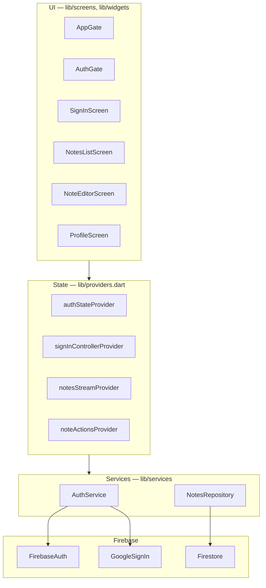
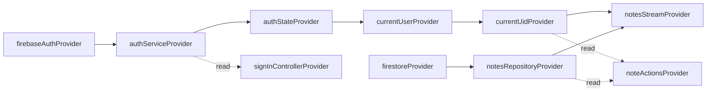

# Architecture

The app has three layers. Widgets read state from Riverpod providers, providers call services, and services are the only code that talks to Firebase.

`AppGate` is the root widget. It shows `AuthGate` (the notes app) unless the device has opened an onboarding deep link, in which case it shows the onboarding screens instead. That second interface has its own services, none of which touch Firebase, and is described in [09-deep-link-onboarding.md](09-deep-link-onboarding.md).

## Folder layout

| Path | Contents |
|------|----------|
| [lib/main.dart](../lib/main.dart) | Entry point: deep-link observer, Firebase and Google Sign-In initialisation, onboarding store load, `NotesApp`, the bootstrap error screen |
| [lib/firebase_options.dart](../lib/firebase_options.dart) | Hand-written Firebase options for Android and iOS |
| [lib/providers.dart](../lib/providers.dart) | Every Riverpod provider and both controllers |
| [lib/models/note.dart](../lib/models/note.dart) | The `Note` model and its Firestore mapping |
| [lib/services/auth_service.dart](../lib/services/auth_service.dart) | Google sign-in and sign-out |
| [lib/services/notes_repository.dart](../lib/services/notes_repository.dart) | Firestore reads and writes for notes |
| [lib/models/onboarding.dart](../lib/models/onboarding.dart) | `OnboardingState`, `OnboardingStage`, `LeadDetails` |
| [lib/supabase_options.dart](../lib/supabase_options.dart) | Supabase URL and anon key, from `--dart-define` |
| [lib/services/install_referrer_service.dart](../lib/services/install_referrer_service.dart) | Reads the Play Store install referrer; referrer marker constants |
| [lib/services/leads_repository.dart](../lib/services/leads_repository.dart) | Saves the onboarding form to Supabase |
| [lib/services/deep_link_service.dart](../lib/services/deep_link_service.dart) | Receives deep links; link host and path constants |
| [lib/services/onboarding_store.dart](../lib/services/onboarding_store.dart) | Onboarding state on the device |
| [lib/services/payment_gateway.dart](../lib/services/payment_gateway.dart) | `PaymentGateway` interface and the simulated implementation |
| [lib/screens/](../lib/screens/) | `AppGate`, `AuthGate`, sign-in, notes list, editor, profile |
| [lib/screens/onboarding/](../lib/screens/onboarding/) | Details form, paywall, member home |
| [lib/widgets/note_tile.dart](../lib/widgets/note_tile.dart) | One row of the notes list |
| [lib/utils/errors.dart](../lib/utils/errors.dart) | `describeError`: maps any thrown object to a user-facing `AppFailure` |
| [lib/utils/format.dart](../lib/utils/format.dart) | `formatNoteTime`: relative time for list rows |
| [lib/utils/validators.dart](../lib/utils/validators.dart) | Validators for the details form |

## Providers

All providers are declared by hand in [providers.dart](../lib/providers.dart). There is no code generation.

| Provider | Type | Role |
|----------|------|------|
| `firebaseAuthProvider` | `Provider<FirebaseAuth>` | The `FirebaseAuth` instance. Override point for tests. |
| `authServiceProvider` | `Provider<AuthService>` | Auth operations |
| `authStateProvider` | `StreamProvider<User?>` | Firebase's auth state stream. Drives `AuthGate`. |
| `currentUserProvider` | `Provider<User?>` | The signed-in user, or null while loading, on error, or signed out |
| `currentUidProvider` | `Provider<String?>` | The user's ID, or null |
| `signInControllerProvider` | `AsyncNotifierProvider<SignInController, SignInState>` | Runs sign-in and sign-out; drives button spinners and error banners |
| `firestoreProvider` | `Provider<FirebaseFirestore>` | The Firestore instance. Override point for tests. |
| `notesRepositoryProvider` | `Provider<NotesRepository>` | Notes data access |
| `notesStreamProvider` | `StreamProvider<List<Note>>` | The live notes list for the current user; an empty list when signed out |
| `noteActionsProvider` | `AsyncNotifierProvider<NoteActions, void>` | Save, delete and restore; holds only loading/error status |
| `deepLinkServiceProvider` | `Provider<DeepLinkService>` | Overridden in `main()` with the instance already observing |
| `onboardingStoreProvider` | `Provider<OnboardingStore>` | Overridden in `main()` with the store loaded before `runApp` |
| `installReferrerProvider` | `Provider<String?>` | The Play install referrer. Null except on the first launch, when `main()` overrides it. |
| `leadsRepositoryProvider` | `Provider<LeadsRepository>` | Supabase when configured; otherwise a stand-in that only works in debug builds |
| `detailsSubmitControllerProvider` | `AsyncNotifierProvider<DetailsSubmitController, void>` | Saves the form, then advances the stage; holds only loading/error status |
| `paymentGatewayProvider` | `Provider<PaymentGateway>` | The simulated gateway. The one line to change for a real provider. |
| `onboardingControllerProvider` | `NotifierProvider<OnboardingController, OnboardingState>` | Which interface and stage to show; persists every change. Drives `AppGate`. |
| `purchaseControllerProvider` | `AsyncNotifierProvider<PurchaseController, void>` | Runs a purchase; holds only loading/error status |

The two providers overridden in `main()` throw `UnimplementedError` if read without the override. Tests must override them.

### Design decisions worth knowing

- **Reads and writes are separate.** Note data always comes from `notesStreamProvider`. `noteActionsProvider` never holds notes; it only reports whether the last write is running or failed.
- **The user ID is passed per call.** `NotesRepository` methods take `uid` as an argument and the repository holds no user state, so it can never be alive in a signed-out state.
- **Navigation follows state.** Controllers never navigate. `AuthGate` watches `authStateProvider` and swaps sign-in for the notes list; `AppGate` watches the onboarding stage and swaps the whole interface. Onboarding stages are swapped at the root, not pushed as routes, so the stage and the screen cannot disagree.
- **`MaterialApp` has no `home`.** It uses `onGenerateInitialRoutes` so that a cold-start deep link is not pushed as a named route. See [09-deep-link-onboarding.md](09-deep-link-onboarding.md#receiving-the-direct-link).
- **A cancelled sign-in is data, not an error.** `SignInController` catches `SignInCanceled` and increments `SignInState.consecutiveCancels`. That count drives the "signing certificate is probably not registered" hint.
- **`notesStreamProvider` overrides Riverpod's retry.** Riverpod 3 retries failed providers by default. The override stops retrying on `permission-denied` and `unauthenticated`, which would otherwise show a spinner for about 30 seconds after sign-out.
- **`currentUserProvider` reads `.value`.** This returns null during loading and error, so no exception from the auth stream reaches the providers below it.
- **Firestore writes are optimistic and not awaited by the UI.** A Firestore write future completes only when the server acknowledges it, which offline means on reconnect. Screens pop first and report failure later through a snackbar. See [03-app-flow.md](03-app-flow.md#saving-a-note).
- **The Supabase save is awaited.** The onboarding form waits for its insert before showing the paywall, because Supabase has no offline cache: an un-awaited insert that failed would be a lost lead.

## Import rules

The intent, stated in the service files, is that Firebase packages stay behind the service layer.

| Package | Intended to be imported only by | Also imported today by |
|---------|--------------------------------|------------------------|
| `google_sign_in` | [auth_service.dart](../lib/services/auth_service.dart) | [errors.dart](../lib/utils/errors.dart), to map `GoogleSignInException` |
| `cloud_firestore` | [notes_repository.dart](../lib/services/notes_repository.dart) | [note.dart](../lib/models/note.dart) for `Timestamp` and `DocumentSnapshot`; [providers.dart](../lib/providers.dart) for the instance and `FirebaseException` |
| `firebase_auth` | services and providers | [auth_gate.dart](../lib/screens/auth_gate.dart), [profile_screen.dart](../lib/screens/profile_screen.dart), [errors.dart](../lib/utils/errors.dart), for the `User` and exception types |
| `shared_preferences` | [onboarding_store.dart](../lib/services/onboarding_store.dart) | Nothing else |
| `supabase` | [leads_repository.dart](../lib/services/leads_repository.dart) | Nothing else |

For new code: screens and widgets must not call `FirebaseAuth`, `FirebaseFirestore` or `GoogleSignIn` directly. They go through providers.

## Error handling

Every error shown to a user passes through `describeError` in [errors.dart](../lib/utils/errors.dart). It unwraps Riverpod's `ProviderException`, then maps `SignInCanceled`, `GoogleSignInException`, `FirebaseAuthException`, `FirebaseException` and `StateError` to an `AppFailure` with a message and an optional hint. Anything else becomes "Something went wrong."

A failure during startup is shown by `_BootstrapErrorApp` in [main.dart](../lib/main.dart) instead of a blank screen.

## Testing

There are two kinds of test.

- **Unit tests.** [widget_test.dart](../test/widget_test.dart) has 8 tests on `Note.displayTitle`, `Note.sortKey` and `formatNoteTime`. [onboarding_logic_test.dart](../test/onboarding_logic_test.dart) has 17 on link and referrer matching, state encoding and validators.
- **Widget tests.** [onboarding_flow_test.dart](../test/onboarding_flow_test.dart) has 21 tests that pump the real `NotesApp`. Firebase is never initialised: `authStateProvider` is overridden with a signed-out stream, which is the only Firebase-backed provider the signed-out path reads. The signed-in notes screens have no widget tests.
- **End-to-end flows.** Seven Maestro flows in `.maestro/` drive the installed app. See [08-e2e-testing.md](08-e2e-testing.md).

Controls with no visible text carry a `Semantics(identifier: ...)` so the flows can select them. The identifiers are listed in [08-e2e-testing.md](08-e2e-testing.md#how-the-flows-are-written).
