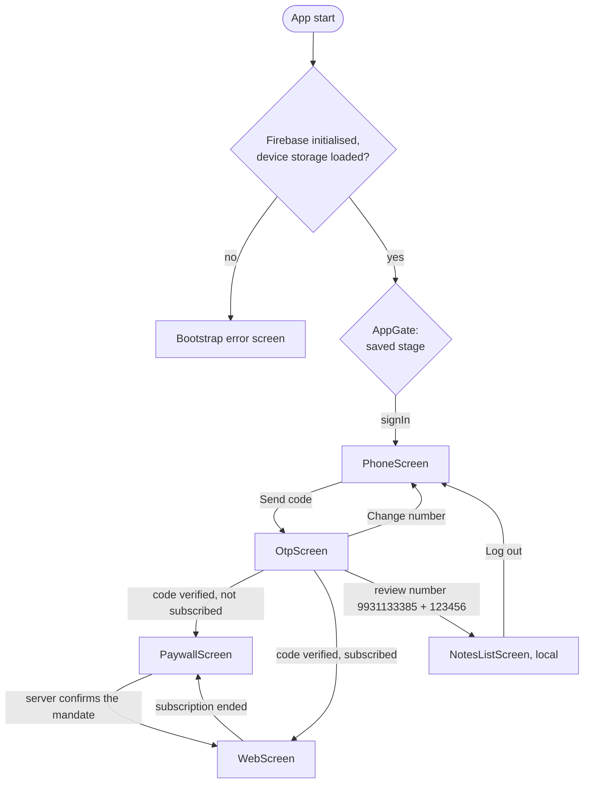

# App flow

## Screens and navigation

Every user signs in with a mobile number and an SMS code. There is no other way in: Google sign-in was removed on 2026-10-22.

`AppGate` is the single root route of the `MaterialApp`. It renders from `onboardingControllerProvider` and never navigates; nothing is pushed on top except sheets and dialogs. The details of each screen, the backend and the review account are in [09-deep-link-onboarding.md](09-deep-link-onboarding.md).

The notes screens (list, editor, profile) are reached only by the review number 9931133385, and store their notes on the device through `LocalNotesStore` (no Firebase). The Firestore-backed notes path those screens used to use is still in the code but unused. Their behaviour is described at the end of this document.

## Startup

In [main.dart](../lib/main.dart):

1. `WidgetsFlutterBinding.ensureInitialized()`.
2. `DeepLinkService.start()`, so it sees incoming links before the framework's own handler. Links no longer change the screen; they are reported to analytics.
3. The `App Opened` analytics event. Mixpanel and the Facebook SDK were already started by `MainActivity`, before any Dart ran.
4. `Firebase.initializeApp` with `DefaultFirebaseOptions.currentPlatform`. Nothing reachable uses Firebase now; it is kept while the notes screens are.
5. `OnboardingStore.open()`, which loads the saved stage, phone session and settings.
6. Until Play has given a settled answer, `InstallReferrerService.fetch()` reads the Play Store install referrer, waiting at most 3 seconds, and the `Install Attributed` event is sent. For attribution only.
7. `runApp`, with the link service, the store and the referrer passed in as provider overrides.

If step 4 or 5 throws, the app runs `_BootstrapErrorApp` and shows "Evos couldn't start" with the reason. This is what happens on web and desktop, which have no Firebase options.

Every screen and action after this reports an analytics event. They are listed in [10-analytics.md](10-analytics.md).

## Notes screens (review number only, local notes)

The review number 9931133385 lands here. The screens read `localNotesStreamProvider` and write through `localNoteActionsProvider` (both backed by `LocalNotesStore` in `shared_preferences`), not Firestore, and there is no Firebase user. Notes are device-local: not synced, gone when the app's data is cleared. The descriptions below are otherwise accurate; where they mention Firestore, offline cache or `createdAt` server stamping, that applied to the old Firebase path, not the local store.

### Notes list

[notes_list_screen.dart](../lib/screens/notes_list_screen.dart) watches `notesStreamProvider`. A pinned bar holds the large "Notes" title and, on the same row, the user's avatar, which opens Profile; "New note" is a floating button.

- **Loading:** a spinner, on first load only.
- **Empty:** "No notes yet" and "Tap New note to write your first one."
- **Error:** the message, a hint, and a "Try again" button that invalidates the provider.
- **Data:** the note count, then one card per note, newest edit first.

Each card ([note_tile.dart](../lib/widgets/note_tile.dart)) shows:

- **Title:** the note's title, or the first line of the body, or "Untitled note".
- **Preview:** up to three lines of the body.
- **Time:** "Just now", "5m ago", "3h ago", "2d ago", then a date such as "4 Mar". It reads "Saving…" while the server timestamp is unresolved.

### Saving a note

[note_editor_screen.dart](../lib/screens/note_editor_screen.dart) handles create (`note == null`) and edit. The note is passed in from the list, not re-fetched.

1. The user taps the round violet check button (tooltip "Save").
2. Title and body are trimmed. If both are empty the screen pops and nothing is written.
3. `NoteActions.save` is called and **not awaited**; the screen pops at once.
4. Firestore writes to its local cache, so the note appears in the list immediately, marked "Saving…" until the server confirms.
5. If the write later fails, a snackbar shows the error.

Leaving with the back button discards the edits without asking.

### Deleting a note

There are two entry points with the same result:

- **Swipe a card left** in the list.
- **Tap the delete icon** in the editor, which also pops the editor.

Then:

1. `NoteActions.delete` is called and not awaited. The row disappears as soon as the local cache updates.
2. A snackbar shows `Deleted "<title>"` with an **Undo** action for 6 seconds.
3. Undo calls `NoteActions.restore`, which writes the note back under the same document ID. Both timestamps are re-stamped, so a restored note moves to the top of the list.

The swipe never removes the row itself: `confirmDismiss` always returns false and the Firestore stream removes it. This avoids Flutter's "dismissed Dismissible is still part of the tree" assertion if the delete fails.

### Profile and sign out

[profile_screen.dart](../lib/screens/profile_screen.dart) shows a generic "Signed in" violet card (the review account has no name, email, photo or id), a card saying the notes are saved on this device, then a full-width **Log out** button.

1. The user taps **Log out** and confirms in a dialog.
2. `OnboardingController.signOut` clears the review-account state (it never had a Firebase or Supabase session) and `AppGate` shows the mobile-number screen.
