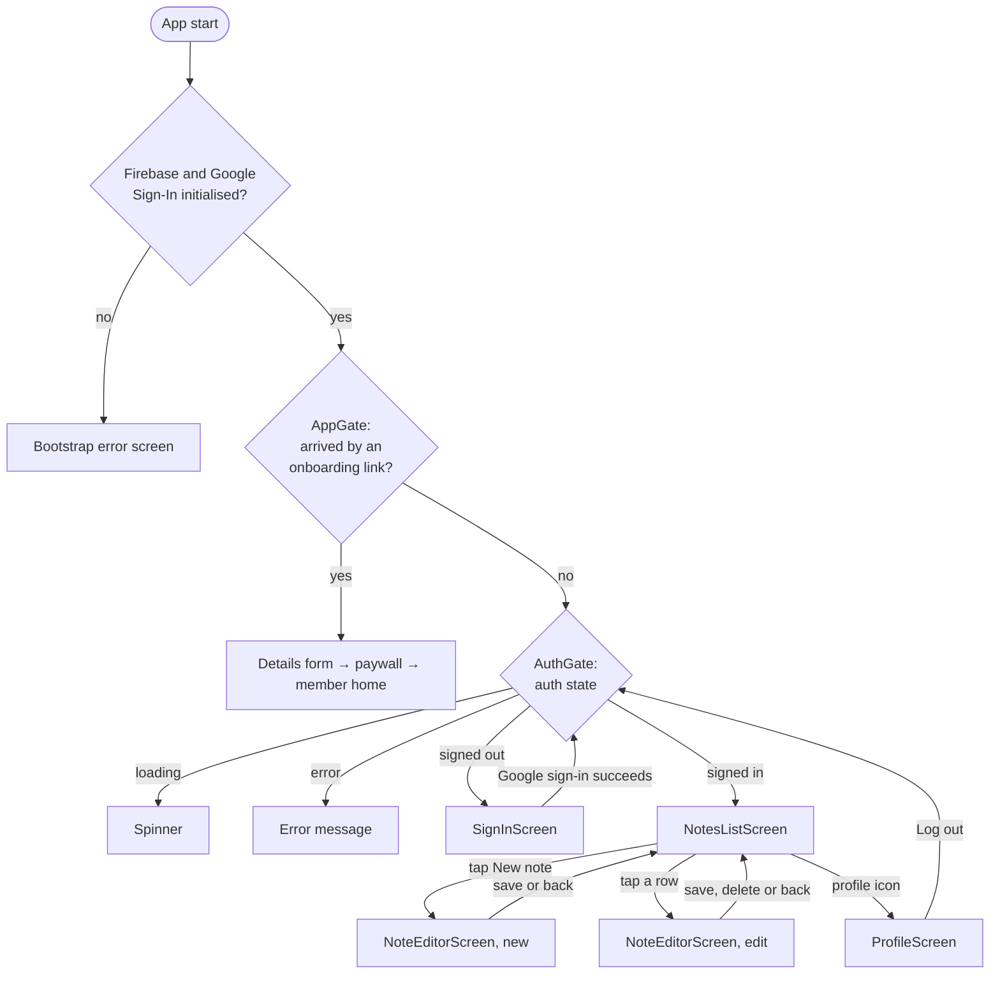
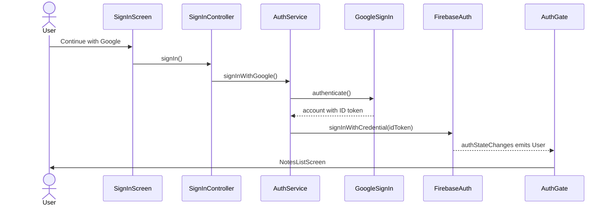

# App flow

## Screens and navigation

Navigation uses `Navigator.push` with `MaterialPageRoute`. There are no named routes and no routing package.

`AppGate` is the single root route of the `MaterialApp`, and `AuthGate` is what it shows for the normal app. `NoteEditorScreen` and `ProfileScreen` are pushed on top.

The onboarding interface, shown to a user who installed from a Play Store onboarding link, is described in [09-deep-link-onboarding.md](09-deep-link-onboarding.md). The rest of this document is the normal notes app.

## Startup

In [main.dart](../lib/main.dart):

1. `WidgetsFlutterBinding.ensureInitialized()`.
2. `DeepLinkService.start()`, so it sees incoming links before the framework's own handler.
3. `Firebase.initializeApp` with `DefaultFirebaseOptions.currentPlatform`.
4. `AuthService.initializeGoogleSignIn()`. This must run exactly once and be awaited before any other `GoogleSignIn.instance` call.
5. `OnboardingStore.open()`, which loads the saved onboarding state.
6. On the first launch only, `InstallReferrerService.fetch()` reads the Play Store install referrer, waiting at most 3 seconds.
7. `runApp`, with the link service, the store and the referrer passed in as provider overrides.

If step 3, 4 or 5 throws, the app runs `_BootstrapErrorApp` and shows "Notes couldn't start" with the reason. This is what happens on web and desktop, which have no Firebase options.

## Sign in

Outcomes other than success:

| Case | What the user sees |
|------|--------------------|
| User dismisses the Google sheet | Nothing on the first cancel in release builds. See the next row. |
| Sign-in is "cancelled" repeatedly | A hint banner that the signing certificate is probably not registered in Firebase. It appears after 1 cancel in debug builds and 2 in release. An unregistered SHA-1 is reported by Android as a cancellation, so this is the only signal. |
| Any other failure | An error banner with the message and hint from `describeError`. |

The button is disabled and shows "Signing in…" while the request runs.

## Notes list

[notes_list_screen.dart](../lib/screens/notes_list_screen.dart) watches `notesStreamProvider`.

- **Loading:** a spinner, on first load only.
- **Empty:** "No notes yet".
- **Error:** the message, a hint, and a "Try again" button that invalidates the provider.
- **Data:** rows sorted newest edit first.

Each row ([note_tile.dart](../lib/widgets/note_tile.dart)) shows:

- **Title:** the note's title, or the first line of the body, or "Untitled note".
- **Preview:** up to two lines of the body.
- **Time:** "Just now", "5m ago", "3h ago", "2d ago", then a date such as "4 Mar". It reads "Saving…" while the server timestamp is unresolved.

## Saving a note

[note_editor_screen.dart](../lib/screens/note_editor_screen.dart) handles create (`note == null`) and edit. The note is passed in from the list, not re-fetched.

1. The user taps the check icon.
2. Title and body are trimmed. If both are empty the screen pops and nothing is written.
3. `NoteActions.save` is called and **not awaited**; the screen pops at once.
4. Firestore writes to its local cache, so the note appears in the list immediately, marked "Saving…" until the server confirms.
5. If the write later fails, a snackbar shows the error.

Leaving with the back button discards the edits without asking.

## Deleting a note

There are two entry points with the same result:

- **Swipe a row left** in the list.
- **Tap the delete icon** in the editor, which also pops the editor.

Then:

1. `NoteActions.delete` is called and not awaited. The row disappears as soon as the local cache updates.
2. A snackbar shows `Deleted "<title>"` with an **Undo** action for 6 seconds.
3. Undo calls `NoteActions.restore`, which writes the note back under the same document ID. Both timestamps are re-stamped, so a restored note moves to the top of the list.

The swipe never removes the row itself: `confirmDismiss` always returns false and the Firestore stream removes it. This avoids Flutter's "dismissed Dismissible is still part of the tree" assertion if the delete fails.

## Profile and sign out

[profile_screen.dart](../lib/screens/profile_screen.dart) shows the user's photo or initials, name, email and user ID.

1. The user taps **Log out** and confirms in a dialog.
2. `SignInController.signOut` signs out of Google (best effort) and then Firebase.
3. `authStateChanges` emits null and `AuthGate` builds `SignInScreen`.
4. If sign-out fails, a snackbar shows the error.

The Profile route is not popped during sign-out. See [07-known-issues.md](07-known-issues.md).
