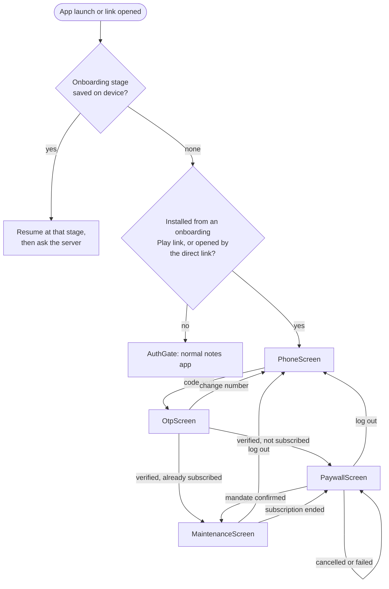
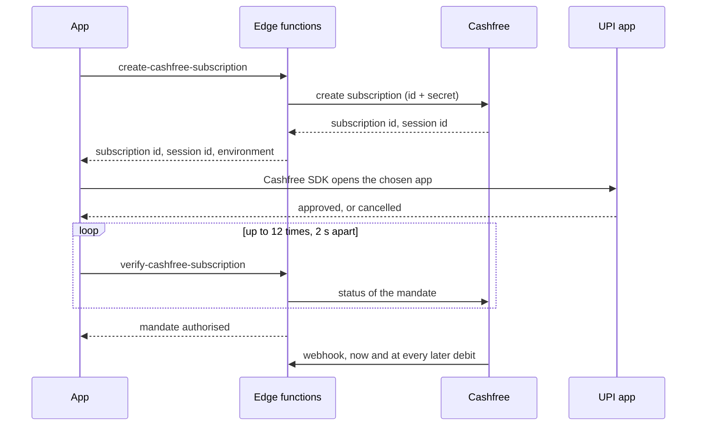
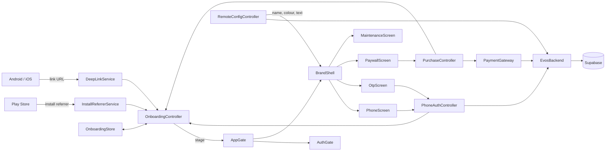

# Deep-link onboarding (Evos)

A user who installs the app from a Play Store onboarding link gets a different interface from everyone else: sign in with a mobile number and an SMS code, a paywall with a Cashfree UPI AutoPay trial, then an "under maintenance" screen. Every other user gets the normal notes app, unchanged.

Inside that interface the app is called **Evos**. Its name, logo, colour, paywall wording, prices and maintenance message come from the backend. The backend is Supabase, built the same way as the CashAlert app's.

**What has and has not run.** The screens, the state logic and the Android payment code are written, tested with fakes, and run on a phone in test mode. **Sign-in works for real** (2026-10-13: a code sent by SMS through the hook and Fast2SMS, verified, new account, paywall shown, on the test phone). **Payment has never run:** the Cashfree settings are unfilled. See [What is not verified](#what-is-not-verified).

There are three ways in:

| Trigger | Link | Use |
|---------|------|-----|
| Local test link | `notes://onboarding` | Verifying the flow on a device. Debug builds only; needs no domain, approval or Play Store. See [Verifying locally](#verifying-locally). |
| Play Store install referrer | `https://play.google.com/store/apps/details?id=com.spacewire.notes&referrer=flow%3Donboarding` | The real one. The user taps it, installs, and the first launch opens the sign-in. |
| Direct link | `https://notes-f36b3.web.app/onboarding` | Opens the sign-in in an app that is already installed. Needs the domain approved on the device. |

## Verifying locally

With a phone connected and a **test-mode** debug build installed (`flutter run --dart-define=SUPABASE_URL=`):

```sh
./tool/deeplink.sh --check    # automated: proves the link works, start to finish
./tool/deeplink.sh --fresh    # clear the app's data, then open the link
./tool/deeplink.sh            # open the link, keeping the app's current state
./tool/deeplink.sh --reset    # clear the app's data: back to the normal app
```

`--check` runs the Maestro flow [deeplink_local.yaml](../.maestro/flows/deeplink_local.yaml), which asserts four things in order:

1. A fresh install with no link shows the normal app.
2. The link arriving while the app is running switches to the mobile-number screen.
3. After a plain restart, with no link, that screen is still shown.
4. The link starting the app from cold opens straight onto it.

All four passed on the test phone (`RZ8T606RJ0N`) on 2026-10-13.

**Test mode.** The app talks to the Evos Supabase project by default. A debug build made with `--dart-define=SUPABASE_URL=` (an empty value) has no backend, so it stands in for one: any valid number is accepted, no SMS is sent, the code is `123456`, and the payment is simulated. All three screens say so ("Test mode: no SMS is sent." on the number and code screens, "Test mode: no payment is taken." on the paywall). A release build made that way refuses at the first step instead.

`deeplink_local` works on any build. `onboarding_deeplink` is for a test-mode build only: on a normal build it would text a code to the number it types, which belongs to a stranger. It asserts the test-mode notice before tapping "Send code", so on a normal build it fails there, having sent nothing.

`notes://onboarding` is a custom-scheme link. It is registered in [src/debug/AndroidManifest.xml](../android/app/src/debug/AndroidManifest.xml) only, so release builds do not respond to it: any app can claim a custom scheme, which makes it unsuitable for production. It exercises the same Dart code path as the HTTPS link. It does not exercise the Play Store referrer, which can only be tested through Play.

## Decisions

Made with the product owner on 2026-10-01 and 2026-10-13.

| Question | Decision |
|----------|----------|
| Who sees this interface | Only users who arrive by the link. A plain Play Store install is the notes app |
| App name in this interface | Evos, from the backend |
| Sign-in | Mobile number and SMS code. One screen for the number, one for the code. A new number becomes an account when its code is verified, so there is no separate sign-up |
| Details form | Removed |
| Backend | Supabase, like CashAlert |
| Payment | Cashfree UPI AutoPay, auto-renewing, the same model as CashAlert: a small amount today for 24 hours, then a monthly debit |
| Paywall layout | The same as CashAlert's |
| After paying | An "under maintenance" screen |
| Way back to the notes app | None, on purpose |

Chosen by the implementer, not confirmed by the product owner:

- **A separate Supabase project from CashAlert,** which is what was then supplied (`sqvlgiqypqvjykczuhgz`). Sharing one would make a CashAlert subscriber an Evos subscriber, because both key the subscription on the phone account.
- **The paywall invents nothing.** CashAlert's shows a star rating, a subscriber count and rotating "… just started a trial" lines that are fixed text in the app. Here those parts appear only if the backend sends them, and are blank by default. The heading pill shows the trial price rather than the word FREE, because the trial is charged.
- **The referrer value.** `flow=onboarding` must match what the marketing links actually carry.
- **Default prices.** ₹3 for 24 hours, then ₹299 a month, until the backend says otherwise.

## Flow



- **The switch is remembered.** Once the link has been opened, the device stays in this interface across restarts.
- **The server decides who has paid.** The stage saved on the device is only what to show first. At every start, whenever the paywall comes back to the front, and on "Check again", the app asks the server and moves between paywall and maintenance to match. A subscriber on a new phone goes from the code screen straight to maintenance.
- **Offline, nothing moves.** If the server cannot be reached the device stays where it last knew it was, so a subscriber is not sent back to the paywall for having no signal.
- **There is no way out, by decision.** Log out returns to the mobile-number screen, not to the notes app. A debug build shows a "Reset deep-link flow" button on the mobile-number and maintenance screens for developers; a release build has nothing.
- **The install referrer is read once,** on the first launch.
- **Opening the direct link again does nothing** once the flow has started, so progress is never lost.
- **A link that arrives while the notes app is open** closes any open editor or profile screen and shows the sign-in. A signed-in Google session is left intact but is not reachable until a reset. The two sign-ins are separate: Google on Firebase for notes, phone on Supabase here.

## Screens

Designs: <https://claude.ai/artifact/R8sDE5Buj8BJo7E14StMTW> (the paywall there predates the CashAlert layout).

| Screen | File | Behaviour |
|--------|------|-----------|
| Mobile number | [phone_screen.dart](../lib/screens/onboarding/phone_screen.dart) | Logo, "Welcome to <name>", one field with a fixed `+91`. "Send code" is off until the number is a valid Indian mobile (ten digits, first digit 6 to 9). A pasted `+91 98765 43210` or `098765…` is reduced to its ten digits. Pre-filled when coming back from the code screen. |
| Code | [otp_screen.dart](../lib/screens/onboarding/otp_screen.dart) | Six boxes over one hidden field, so paste and the keyboard's SMS suggestion work. The sixth digit verifies by itself; "Verify" is there too. A wrong code empties the boxes. "Resend code" appears after 30 seconds. Back, in the app bar or the system's, returns to the number. |
| Paywall | [paywall_screen.dart](../lib/screens/onboarding/paywall_screen.dart) | CashAlert's layout: logo and "Log out" on top; heading with a pill; rating; preview picture; up to four feature badges; the monthly price struck through beside the trial price; a rotating line of social proof; a bottom bar with the UPI app on the left and "Try Now" on the right. Each part with nothing to show is left out. |
| Maintenance | [maintenance_screen.dart](../lib/screens/onboarding/maintenance_screen.dart) | Heading and message from the backend, "Check again", "Log out". |

One sentence on the paywall never comes from the backend and is always shown: "₹3 today for the first 24 hours, then ₹299 every month by UPI AutoPay. Cancel any time in your UPI app.", with the two amounts filled in. It is the statement that money will be taken every month.

The paywall has no preview **video**, which CashAlert's has. It shows a picture from `paywall_preview_image_url`.

## Backend

Everything is in [supabase/](../supabase/), adapted from CashAlert's. It is deployed to the project. `sms-hook` has delivered a real code; **the three Cashfree functions have not handled a real request yet**.

| Part | File | Role |
|------|------|------|
| SMS settings rows | [migrations/20261013130000_sms_config_rows.sql](../supabase/migrations/20261013130000_sms_config_rows.sql) | Adds the four SMS rows where the first migration ran before it had them |
| Tables and policies | [migrations/20261013120000_evos_init.sql](../supabase/migrations/20261013120000_evos_init.sql) | `app_config`, `profiles`, `subscription_payments`, the `has_active_subscription()` function, and a trigger that makes a profile for each new sign-in |
| `sms-hook` | [functions/sms-hook/](../supabase/functions/sms-hook/index.ts) | Supabase Auth makes and checks the code; this delivers it through Fast2SMS |
| `create-cashfree-subscription` | [functions/create-cashfree-subscription/](../supabase/functions/create-cashfree-subscription/index.ts) | Creates the mandate with the Cashfree id and secret and returns a session id |
| `verify-cashfree-subscription` | [functions/verify-cashfree-subscription/](../supabase/functions/verify-cashfree-subscription/index.ts) | Asks Cashfree whether the mandate went through and records the payment |
| `cashfree-webhook` | [functions/cashfree-webhook/](../supabase/functions/cashfree-webhook/index.ts) | Records each monthly debit, failure, cancellation and expiry. This is what keeps access going after the first day |

Left out of the CashAlert original: push notifications, server-side Mixpanel events, the failed-debit retry job, the status-event log and the daily report.

### Settings: the `app_config` table

Key and value rows, edited in the Supabase Table Editor. A third column, `is_public`, decides who can read a row. The app reads the public rows with the anon key; row-level security returns nothing else, however it is asked.

| Key | Public | Meaning | Default |
|-----|--------|---------|---------|
| `app_name` | yes | Name shown in the interface and in the recent-apps list | `Evos` |
| `app_logo_url` | yes | HTTPS image. Blank shows the first letter of the name on a tile | blank |
| `theme_color` | yes | `#RRGGBB`. The whole colour scheme is generated from it | `#6D28D9` |
| `paywall_title_prefix`, `paywall_title_badge`, `paywall_title_suffix` | yes | The three parts of the heading. A blank badge shows the trial price | `1-Day`, blank, `Trial` |
| `paywall_rating_value`, `paywall_rating_caption` | yes | Stars and the text beside them. Blank hides the row | blank |
| `paywall_preview_image_url` | yes | HTTPS image. Blank hides the card | blank |
| `paywall_features` | yes | Up to four badges, separated by `\|` | `Full access\|Cancel anytime\|Secure UPI AutoPay` |
| `paywall_social_proofs` | yes | Rotating lines, separated by `\|`. Blank hides the strip | blank |
| `maintenance_title`, `maintenance_message` | yes | The maintenance screen | see the migration |
| `plan_name` | yes | Plan name given to Cashfree when no plan id is set | `Evos Premium Monthly` |
| `cashfree_plan_id` | yes | A plan made in the Cashfree dashboard. Blank: the plan is described inline from the amounts | blank |
| `cashfree_trial_amount` | yes | Rupees authorised today | `3` |
| `cashfree_recurring_amount` | yes | Rupees debited each month | `299` |
| `cashfree_app_id`, `cashfree_secret_key` | **no** | Cashfree credentials | blank |
| `cashfree_environment` | **no** | `production` takes real money; anything else is sandbox | `sandbox` |
| `customer_email_domain` | **no** | A domain the business owns. Cashfree needs an email per customer and a phone sign-in has none, so one is made as `user+<phone>@<domain>` | blank |
| `fast2sms`, `fast2sms_dlt_sender_id`, `fast2sms_dlt_te_id` | **no** | Fast2SMS API key, DLT sender id and template (message) id, read by `sms-hook`. The same three keys CashAlert's table has, to be filled with the same values | blank |
| `send_sms_hook_secret` | **no** | The secret the dashboard shows when the Send SMS hook is saved | blank |

- **The Cashfree id and secret never reach the app.** They are private rows, read only by edge functions with the service role. The app receives a single-use session id. Never mark either row public.
- The app keeps the last settings it fetched on the device, so the next start is already branded before the network answers, and still is with no network. A missing row, a blank value or a bad one (a colour that is not `#RRGGBB`, a negative price, an `http:` image) falls back to the default rather than breaking a screen. Parsing is in [remote_config.dart](../lib/models/remote_config.dart).
- **The launcher icon and the name under it do not change.** Android fixes them when the app is built. On the home screen the app is still "notes".
- The two amounts are read twice: by the app to show them, and by the server to charge them. Both read the same rows.

### Sign-in

`signInWithOtp` and `verifyOTP` on Supabase Auth, called from [evos_backend.dart](../lib/services/evos_backend.dart). The number is always sent as `+91` and ten digits.

The pure-Dart `supabase` client keeps a session in memory only, so the app saves it itself: each new or refreshed session is written to the device as JSON, and put back before the first call that needs it. A session the server refuses (revoked, or the account deleted) is dropped and the user signs in again.

The SMS is not read automatically. The code field carries the one-time-code autofill hint, so a keyboard that offers the code from Messages can fill it. CashAlert uses the SMS User Consent API; this app does not.

### Payment



- `PaymentGateway` in [payment_gateway.dart](../lib/services/payment_gateway.dart) has `upiApps()`, `subscribe(app)` and `isSimulated`. `CashfreePaymentGateway` is used when a Supabase project is configured; otherwise `SimulatedPaymentGateway`.
- The Cashfree SDK (2.4.0, the version CashAlert uses) is called from Kotlin in [PaymentsChannel.kt](../android/app/src/main/kotlin/com/spacewire/notes/payments/PaymentsChannel.kt) over the channel `com.spacewire.notes/payments`. It offers PhonePe, Google Pay, Paytm and BHIM, whichever are installed, and preselects the first.
- `subscribe` completes on success, throws `PaymentCanceled` when the user backs out of the UPI app, and throws `PaymentFailure` or `BackendFailure` otherwise.
- **A payment still being confirmed is not called a failure.** If Cashfree has not confirmed within about 24 seconds the paywall says so and asks the user to reopen the app. When the paywall next comes to the front, or the app next starts, the server is asked again and a completed payment lets the user in.
- **Asking to pay when already subscribed** gets a 409 from the server, and the app simply lets the user in.
- **Tapping "Try Now" again after a pending payment creates a second mandate.** The server only refuses once the first one is confirmed. This is inherited from CashAlert.
- Whether the subscription is active is the SQL function `has_active_subscription()`: trial or active and not past its end date, or cancelled but still inside the period already paid for.

## How it is built



| Part | File | Role |
|------|------|------|
| `InstallReferrerService` | [install_referrer_service.dart](../lib/services/install_referrer_service.dart), [MainActivity.kt](../android/app/src/main/kotlin/com/spacewire/notes/MainActivity.kt) | Reads the Play Store install referrer through a method channel |
| `DeepLinkService` | [deep_link_service.dart](../lib/services/deep_link_service.dart) | Receives the direct link from the platform |
| `EvosBackend` | [evos_backend.dart](../lib/services/evos_backend.dart), [supabase_options.dart](../lib/supabase_options.dart) | Sign-in, settings, subscription status and the two payment functions. `SupabaseEvosBackend`, or `UnconfiguredEvosBackend` (test mode) with no project |
| `PaymentGateway` | [payment_gateway.dart](../lib/services/payment_gateway.dart), [PaymentsChannel.kt](../android/app/src/main/kotlin/com/spacewire/notes/payments/PaymentsChannel.kt) | Cashfree UPI AutoPay, or the simulated stand-in |
| `OnboardingStore` | [onboarding_store.dart](../lib/services/onboarding_store.dart) | The stage, the session and the last settings, on the device |
| `RemoteConfig` | [remote_config.dart](../lib/models/remote_config.dart) | The settings, with defaults and parsing |
| `OnboardingState` | [onboarding.dart](../lib/models/onboarding.dart) | The stage and its JSON form |
| `OnboardingController`, `RemoteConfigController`, `PhoneAuthController`, `PurchaseController` | [providers.dart](../lib/providers.dart) | Stage and entitlement; settings; sending and checking the code; starting the subscription |
| `BrandShell`, `BrandLogo`, `BrandHeader` | [brand.dart](../lib/widgets/brand.dart) | Apply the backend's name and colour to this interface only; draw the logo |
| `AppGate` | [app_gate.dart](../lib/screens/app_gate.dart) | Root widget; renders the screen for the current stage |

### The Play Store referrer

A Play Store link can carry a `referrer` parameter. Play keeps it through the install and hands it to the app afterwards. The app starts onboarding when that referrer, read as a query string, contains `flow=onboarding`. Campaign parameters can sit alongside it: `referrer=utm_source%3Dmail%26flow%3Donboarding`.

- **No plugin.** [MainActivity.kt](../android/app/src/main/kotlin/com/spacewire/notes/MainActivity.kt) exposes Google's Install Referrer library on the channel `com.spacewire.notes/install_referrer`.
- **Read in `main()`, before `runApp`,** with a 3-second limit, so the first frame is already the right interface.
- **Read once.** A successful read sets `install_referrer_checked` on the device. A failed read (no Play Store, timeout) is left unset and tried again on the next launch.
- **Android only.** On iOS the read returns nothing, and there is no equivalent App Store mechanism.

An install that did not come from a link returns Play's default, `utm_source=google-play&utm_medium=organic`, which does not start onboarding.

### Receiving the direct link

No plugin is used. Flutter already delivers links, and `DeepLinkService` reads them:

- **Cold start:** the link is the platform's initial route name.
- **While running:** the link arrives through `WidgetsBindingObserver.didPushRouteInformation`.

Two framework behaviours shape the code, and both are easy to break:

- **`DeepLinkService.start()` must run before `runApp`.** Flutter asks observers in registration order and stops at the first that handles the link. `WidgetsApp` registers its own, which pushes the link as a named route. Registering first keeps links out of the Navigator.
- **`MaterialApp` has no `home`.** With `home`, a cold-start link makes the Navigator try to push the URL as a route and report an error. [main.dart](../lib/main.dart) uses `onGenerateInitialRoutes` and `onGenerateRoute` to always start on the single `AppGate` route. Flutter does not allow `home` and `onGenerateInitialRoutes` together.

### What is stored on the device

Three keys in `shared_preferences`:

| Key | Holds |
|-----|-------|
| `onboarding_v1` | `{"stage": "paywall"}`. One of `inactive`, `signIn`, `paywall`, `maintenance` |
| `evos_session_v1` | The Supabase session as JSON (access and refresh tokens) |
| `evos_config_v1` | The public settings as last fetched |

- The stage is loaded before `runApp`, so the first frame is already the right interface.
- A missing, corrupt or unrecognised stage decodes to "inactive", so bad data can never lock a user out of the notes app.
- A stage saved by the earlier build (`details`, `member`) decodes to `signIn`: that device is still in the flow but has no account.
- A stage past sign-in with no session on the device is shown as sign-in.
- The mobile number and the code are never stored. The debug reset clears the stage and the session, and keeps the settings.
- Each step is reported to analytics, without the number or the code. The events are in [10-analytics.md](10-analytics.md#onboarding).

## Setting up the backend

The project is `sqvlgiqypqvjykczuhgz` (`https://sqvlgiqypqvjykczuhgz.supabase.co`), created 2026-10-13, and its URL and publishable key are the defaults in [supabase_options.dart](../lib/supabase_options.dart). **Done on 2026-10-13: steps 1 to 5** (linked, both migrations applied, four functions deployed, Send SMS hook set, Phone enabled, SMS rows filled with CashAlert's values). **Not done: the Cashfree part of step 6, and step 7.** All of them change a live project and need the owner's go-ahead. The Supabase CLI is at `~/.local/bin/supabase` and is logged in to the account that owns the project.

[tool/setup_backend.sh](../tool/setup_backend.sh) does steps 1, 2 and 5: `deploy` links, pushes the schema and deploys the four functions; `check` reports, read-only, what the project has. The SMS settings are four `app_config` rows, not function secrets, so there is nothing to push for them. (`secrets` pushes an optional `supabase/functions/.env`; a secret is used only when its row is empty.)

1. **Link the project:** `supabase link --project-ref sqvlgiqypqvjykczuhgz`.
2. **Apply the schema:** `supabase db push`.
3. **Deploy the functions** (step 5 below, done by the script) so the hook has a URL to point at.
4. **SMS.** (The Phone provider form will not save with empty Twilio fields; any placeholder text works, and the hook makes them unused.) Authentication → Hooks → Send SMS hook → HTTPS, `https://sqvlgiqypqvjykczuhgz.supabase.co/functions/v1/sms-hook`; save and copy the secret. Authentication → Sign In / Providers → Phone → enable. Then fill four `app_config` rows: `fast2sms`, `fast2sms_dlt_sender_id` and `fast2sms_dlt_te_id` with the values from CashAlert's `app_config`, and `send_sms_hook_secret` with the secret just copied. With CashAlert's template the SMS wording is CashAlert's until Evos has its own DLT template.
5. **Deploy the functions:** `supabase functions deploy` for each of `sms-hook`, `create-cashfree-subscription`, `verify-cashfree-subscription`, `cashfree-webhook`. Type-check first with `deno check` (Deno is not installed on this machine).
6. **Fill in `app_config`:** `cashfree_app_id`, `cashfree_secret_key`, `customer_email_domain`, and the brand and paywall rows. Leave `cashfree_environment` as `sandbox` until tested.
7. **Cashfree dashboard:** enable Subscriptions, add the webhook URL `https://<ref>.supabase.co/functions/v1/cashfree-webhook`, and ask Cashfree to whitelist the package `com.spacewire.notes` for production.
8. **Build the app.** Nothing to pass: a plain `flutter run` or `flutter build` uses this project. The publishable key is safe to ship; row-level security is what protects the data. To point a build at another project:

   ```sh
   flutter run \
     --dart-define=SUPABASE_URL=https://<ref>.supabase.co \
     --dart-define=SUPABASE_ANON_KEY=<publishable key>
   ```
9. **For a Play Store reviewer,** add a test number and fixed code under Authentication → Phone → Test phone numbers, and give that account a long trial by hand in `profiles`.

## Platform setup

### Android

**Play Store link.** Nothing to configure in the app. The install referrer only exists for installs that go through Play, so it can be tested only with a build on a Play testing track (internal testing or internal app sharing), opened through a link with the `referrer` parameter. A build installed with `adb` or `flutter run` always reports an organic install.

**UPI apps.** [AndroidManifest.xml](../android/app/src/main/AndroidManifest.xml) lists the four UPI packages under `<queries>`. Android 11 and later hides any app not listed there, so the list must match `UPI_APPS` in `PaymentsChannel.kt`.

**Direct link.** The manifest declares an `autoVerify` intent filter for `https://notes-f36b3.web.app/onboarding`. The host there must equal `kDeepLinkHost` in [deep_link_service.dart](../lib/services/deep_link_service.dart). This link is a development aid; the domain was the implementer's default and hosts nothing.

Android would open the direct link in the app without asking only if the domain served this file at `https://notes-f36b3.web.app/.well-known/assetlinks.json`:

```json
[{
  "relation": ["delegate_permission/common.handle_all_urls"],
  "target": {
    "namespace": "android_app",
    "package_name": "com.spacewire.notes",
    "sha256_cert_fingerprints": [
      "D3:D7:62:74:68:BB:CE:E9:E8:FF:92:7D:FA:05:7B:50:1B:7B:BD:6A:14:E0:5C:BA:7B:8E:03:CE:E0:B9:30:96"
    ]
  }
}]
```

That fingerprint is this machine's **debug** key. Add the release key's SHA-256 before publishing, and each developer's debug key if they need verified links.

It is not hosted and does not need to be for the Play Store route. For development, approve the domain on the device, once:

```sh
adb shell pm set-app-links-user-selection --user cur --package com.spacewire.notes true notes-f36b3.web.app
```

Then open the link:

```sh
adb shell am start -a android.intent.action.VIEW -d "https://notes-f36b3.web.app/onboarding"
```

### iOS

Not configured. The Play Store route does not exist there, an iOS link would need Universal Links (a paid Apple Developer team and an `apple-app-site-association` file), and the payment code is Android-only: on iOS the paywall would find no UPI apps.

## Tests

- [onboarding_logic_test.dart](../test/onboarding_logic_test.dart): link and referrer matching, stage encoding including the old build's values, the mobile-number rules, and `RemoteConfig` parsing and fallbacks.
- [onboarding_flow_test.dart](../test/onboarding_flow_test.dart): widget tests that pump the real `NotesApp` through every way in, the number and code screens (validation, failure, retry, wrong code, resend, change number), the paywall (backend text, prices and colour, UPI app choice, success, decline, cancel, pending, already subscribed), maintenance, log out, and restarts (lapsed subscription, missed payment, offline, refused session, the old build's stage, reset).
- [analytics_test.dart](../test/analytics_test.dart): the events the flow sends, in order, and that neither the number nor the code is among them.
- [support/harness.dart](../test/support/harness.dart): the fake backend, fake gateway and launch helper the two widget-test files share.
- [deeplink_local.yaml](../.maestro/flows/deeplink_local.yaml) and [onboarding_deeplink.yaml](../.maestro/flows/onboarding_deeplink.yaml): the link, and the whole journey in test mode, on a device. Both passed on the test phone on 2026-10-13.

## What is not verified

- **Parts of sign-in.** Working on the test phone against the live project (2026-10-13): the settings fetch, a code sent and verified for a new number, the session saved, the paywall reached. Not seen: a returning number, a wrong or expired code from the real server, resend, a session restored after a restart or refreshed after it expires, log out, and the status check answering "subscribed".
- **The three Cashfree functions.** Deployed, which means they bundled, but none has handled a real request. `sms-hook` has.
- **A real payment.** `CashfreePaymentGateway` and `PaymentsChannel.kt` compile and the app builds with the SDK, but the Cashfree sheet has never been opened from this app, in sandbox or production. That `action_cancelled` is the SDK's code for a user cancel was read from the SDK's classes, not observed.
- **A backend-supplied logo or preview picture.** Only the letter tile has been seen on a device.
- **A real install through a Play Store referrer link.**

## Open items

Listed in [07-known-issues.md](07-known-issues.md#deep-link-onboarding).
