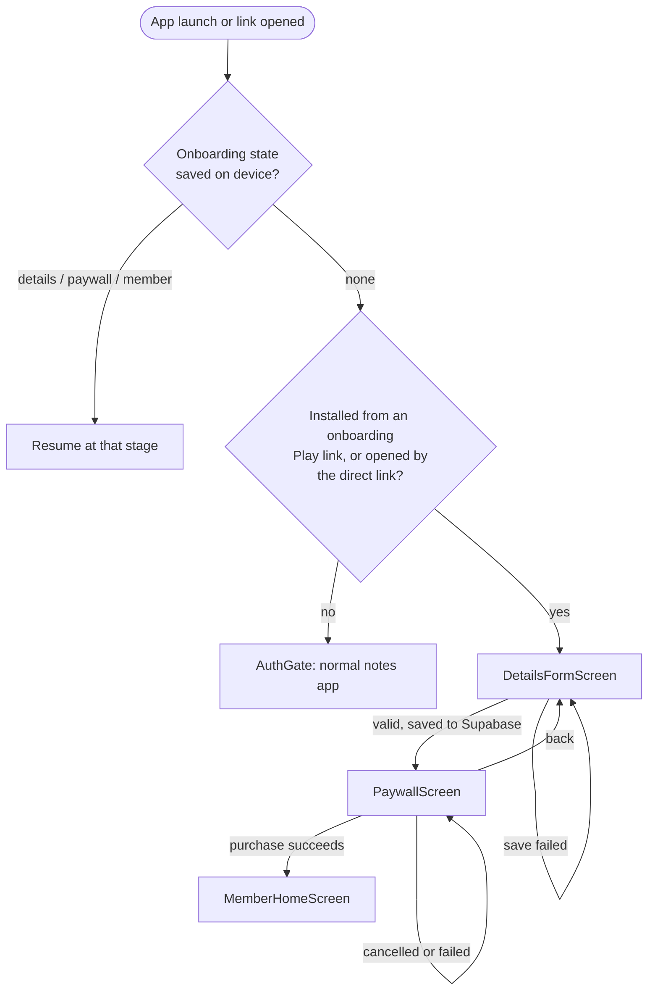
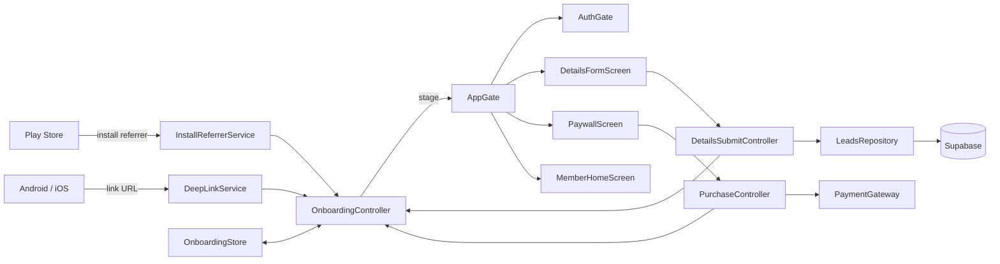

# Deep-link onboarding

A user who installs the app from a Play Store onboarding link gets a different interface from everyone else: a details form, then a paywall, then a member home. Every other user gets the normal notes app, unchanged.

There are three ways in:

| Trigger | Link | Use |
|---------|------|-----|
| Local test link | `notes://onboarding` | Verifying the flow on a device. Debug builds only; needs no domain, approval or Play Store. See [Verifying locally](#verifying-locally). |
| Play Store install referrer | `https://play.google.com/store/apps/details?id=com.spacewire.notes&referrer=flow%3Donboarding` | The real one. The user taps it, installs, and the first launch opens the form. |
| Direct link | `https://notes-f36b3.web.app/onboarding` | Opens the form in an app that is already installed. Needs the domain approved on the device. |

## Verifying locally

With a phone connected and a debug build installed (`flutter run`):

```sh
./tool/deeplink.sh --check    # automated: proves the link works, start to finish
./tool/deeplink.sh --fresh    # clear the app's data, then open the link
./tool/deeplink.sh            # open the link, keeping the app's current state
./tool/deeplink.sh --reset    # clear the app's data: back to the normal app
```

`--check` runs the Maestro flow [deeplink_local.yaml](../.maestro/flows/deeplink_local.yaml), which asserts four things in order:

1. A fresh install with no link shows the normal app.
2. The link arriving while the app is running switches to the form.
3. After a plain restart, with no link, the form is still shown.
4. The link starting the app from cold opens straight onto the form.

All four passed on a Samsung SM-M127G, Android 13, on 2026-10-01.

The same link by hand, without the script:

```sh
adb shell am start -a android.intent.action.VIEW -d "notes://onboarding"
```

`notes://onboarding` is a custom-scheme link. It is registered in [src/debug/AndroidManifest.xml](../android/app/src/debug/AndroidManifest.xml) only, so release builds do not respond to it: any app can claim a custom scheme, which makes it unsuitable for production. It exercises the same Dart code path as the HTTPS link. It does not exercise the Play Store referrer, which can only be tested through Play.

## Decisions

Made with the product owner on 2026-10-01.

| Question | Decision |
|----------|----------|
| Payment | Simulated for now, behind an interface a real provider can replace |
| Link | A Play Store link; no `assetlinks.json` needed |
| Sign-in | None. The form and paywall come before any account exists |
| Form details | Saved to Supabase |
| After paying | A separate interface, not the notes list |
| Way back to the notes app | None, on purpose |

Still open:

- **The member home.** [member_home_screen.dart](../lib/screens/onboarding/member_home_screen.dart) is a placeholder that confirms the purchase and lists the submitted details. What it should contain has not been specified.
- **The Supabase project.** No URL or key has been supplied, so nothing is saved yet. See [Saving the details](#saving-the-details).
- **The referrer value.** `flow=onboarding` is my choice of marker. It must match what the marketing links actually carry.

## Flow



- **The switch is remembered.** Once the link has been opened, the device stays in the onboarding interface across restarts, at whichever stage was reached.
- **There is no way out, by decision.** A deep-link user never reaches the notes app. A debug build shows a "Reset deep-link flow" button on the member home for developers; a release build has nothing.
- **The install referrer is read once,** on the first launch. It cannot change after install, and reading it again after a debug reset would put the device straight back into onboarding.
- **Opening the direct link again does nothing** once the flow has started, so progress is never lost.
- **A link that arrives while the notes app is open** closes any open editor or profile screen and shows the form. A signed-in Google session is left intact but is not reachable until a reset.

## Screens

| Screen | File | Behaviour |
|--------|------|-----------|
| Details form | [details_form_screen.dart](../lib/screens/onboarding/details_form_screen.dart) | Name, email, phone, address. All required. Errors show after the first Continue, then update as the user types. Continue saves to Supabase and shows a spinner; the paywall appears only once the save succeeds. A failed save shows "We couldn't save your details." and keeps what was typed. Pre-filled when returning from the paywall. |
| Paywall | [paywall_screen.dart](../lib/screens/onboarding/paywall_screen.dart) | Plan cards, first one preselected. "Subscribe for <price>" runs the purchase. Back (app bar or system) returns to the form. Shows "Test mode: no payment is taken." while the gateway is simulated. |
| Member home | [member_home_screen.dart](../lib/screens/onboarding/member_home_screen.dart) | Placeholder: confirmation, plan, submitted details. |

Validation rules are in [validators.dart](../lib/utils/validators.dart):

| Field | Rule |
|-------|------|
| Name | 2 to 200 characters |
| Email | `something@something.tld`, no spaces, at most 320 characters |
| Phone | 7 to 15 digits, optional leading `+`; spaces, dashes, dots and brackets are ignored; at most 32 characters as typed |
| Address | 5 to 1,000 characters |

The upper limits match the column checks on the Supabase table, so a value the form accepts is one the server accepts.

## How it is built



| Part | File | Role |
|------|------|------|
| `InstallReferrerService` | [install_referrer_service.dart](../lib/services/install_referrer_service.dart), [MainActivity.kt](../android/app/src/main/kotlin/com/spacewire/notes/MainActivity.kt) | Reads the Play Store install referrer through a method channel. Holds the marker constants and `isOnboardingReferrer`. |
| `DeepLinkService` | [deep_link_service.dart](../lib/services/deep_link_service.dart) | Receives the direct link from the platform. Holds the host and path constants and `isOnboardingLink`. |
| `LeadsRepository` | [leads_repository.dart](../lib/services/leads_repository.dart), [supabase_options.dart](../lib/supabase_options.dart) | Saves the form to Supabase |
| `OnboardingStore` | [onboarding_store.dart](../lib/services/onboarding_store.dart) | Reads and writes the state on the device |
| `PaymentGateway` | [payment_gateway.dart](../lib/services/payment_gateway.dart) | Interface, plus `SimulatedPaymentGateway` |
| `OnboardingState`, `LeadDetails` | [onboarding.dart](../lib/models/onboarding.dart) | Stage, details, plan, and their JSON form |
| `OnboardingController`, `DetailsSubmitController`, `PurchaseController` | [providers.dart](../lib/providers.dart) | Stage transitions; saving the form; running a purchase |
| `AppGate` | [app_gate.dart](../lib/screens/app_gate.dart) | Root widget; renders the screen for the current stage |

### The Play Store referrer

A Play Store link can carry a `referrer` parameter. Play keeps it through the install and hands it to the app afterwards. The app starts onboarding when that referrer, read as a query string, contains `flow=onboarding`. Campaign parameters can sit alongside it: `referrer=utm_source%3Dmail%26flow%3Donboarding`.

- **No plugin.** [MainActivity.kt](../android/app/src/main/kotlin/com/spacewire/notes/MainActivity.kt) exposes Google's Install Referrer library on the channel `com.spacewire.notes/install_referrer`.
- **Read in `main()`, before `runApp`,** with a 3-second limit, so the first frame is already the right interface.
- **Read once.** A successful read sets `install_referrer_checked` on the device. A failed read (no Play Store, timeout) is left unset and tried again on the next launch.
- **Android only.** On iOS the read returns nothing, and there is no equivalent App Store mechanism.

An install that did not come from a link returns Play's default, `utm_source=google-play&utm_medium=organic`, which does not start onboarding.

### Receiving the direct link

No plugin is used. Flutter already delivers links, and `DeepLinkService` reads them:

- **Cold start:** the link is the platform's initial route name.
- **While running:** the link arrives through `WidgetsBindingObserver.didPushRouteInformation`.

Two framework behaviours shape the code, and both are easy to break:

- **`DeepLinkService.start()` must run before `runApp`.** Flutter asks observers in registration order and stops at the first that handles the link. `WidgetsApp` registers its own, which pushes the link as a named route. Registering first keeps links out of the Navigator.
- **`MaterialApp` has no `home`.** With `home`, a cold-start link makes the Navigator try to push the URL as a route and report an error. [main.dart](../lib/main.dart) uses `onGenerateInitialRoutes` and `onGenerateRoute` to always start on the single `AppGate` route. Flutter does not allow `home` and `onGenerateInitialRoutes` together.

### State and storage

The state is one JSON string under the key `onboarding_v1` in `shared_preferences`:

```json
{"stage": "paywall", "details": {"name": "…", "email": "…", "phone": "…", "address": "…"}, "planId": null}
```

- It is loaded before `runApp`, so the first frame is already the right interface.
- A missing, corrupt or unrecognised value decodes to "inactive", so bad data can never lock a user out of the notes app.
- The stage and the entitlement exist only on the device and are lost on uninstall. The form details are also sent to Supabase.

### Saving the details

Continue on the form calls `LeadsRepository.save`, which inserts one row into the Supabase table `onboarding_leads`. The form waits for the insert; unlike a Firestore note there is no local copy to fall back on.

The project is supplied at build time:

```sh
flutter run \
  --dart-define=SUPABASE_URL=https://<ref>.supabase.co \
  --dart-define=SUPABASE_ANON_KEY=<anon key>
```

**Without those, nothing is saved.** A debug build logs `[leads] Supabase is not configured` and carries on to the paywall, so the flow can be developed without credentials. A release build shows the save error and does not advance.

The table and its policy, to run once in the Supabase SQL editor:

```sql
create table public.onboarding_leads (
  id         bigint generated always as identity primary key,
  name       text not null check (char_length(name) between 2 and 200),
  email      text not null check (char_length(email) <= 320),
  phone      text not null check (char_length(phone) <= 32),
  address    text not null check (char_length(address) between 5 and 1000),
  created_at timestamptz not null default now()
);

alter table public.onboarding_leads enable row level security;

create policy "anon can insert leads"
  on public.onboarding_leads for insert to anon
  with check (true);
```

- **Insert only.** There is no select, update or delete policy, so the anon key in the app cannot read anyone's details. This is what makes it safe to ship the key.
- **Editing creates a second row.** A user who goes back from the paywall and resubmits inserts again, because updating would need a policy that lets anon change rows. The newest row per email is the current one.
- **The chosen plan is not recorded.** Only the form is saved.
- **The pure-Dart `supabase` package is used, not `supabase_flutter`.** The Flutter package adds an auth deep-link plugin that would compete with `DeepLinkService` for incoming links.

### Payment

`PaymentGateway` has `plans`, `purchase(plan)` and `isSimulated`. `purchase` completes on success, throws `PaymentCanceled` when the user backs out, and throws anything else on failure.

`SimulatedPaymentGateway` waits 1.2 seconds and succeeds. Its two plans (Yearly ₹1,499, Monthly ₹199) are placeholders, not real products.

To add a real provider: implement `PaymentGateway`, then change `paymentGatewayProvider` in [providers.dart](../lib/providers.dart). No screen changes. A real provider also needs the entitlement verified on a server; a flag on the device can be forged.

## Platform setup

### Android

**Play Store link.** Nothing to configure in the app. The install referrer only exists for installs that go through Play, so it can be tested only with a build on a Play testing track (internal testing or internal app sharing), opened through a link with the `referrer` parameter. A build installed with `adb` or `flutter run` always reports an organic install.

**Direct link.** [AndroidManifest.xml](../android/app/src/main/AndroidManifest.xml) declares an `autoVerify` intent filter for `https://notes-f36b3.web.app/onboarding`. The host there must equal `kDeepLinkHost` in [deep_link_service.dart](../lib/services/deep_link_service.dart). This link is a development aid; the domain was my default and hosts nothing.

Android would open the direct link in the app without asking only if the domain served this file at `https://notes-f36b3.web.app/.well-known/assetlinks.json`:

```json
[{
  "relation": ["delegate_permission/common.handle_all_urls"],
  "target": {
    "namespace": "android_app",
    "package_name": "com.spacewire.notes",
    "sha256_cert_fingerprints": [
      "D3:D7:62:74:68:BB:CE:E9:E8:FF:92:7D:FA:05:7B:50:1B:7B:BD:6A:14:E0:5C:BA:7B:8E:03:CE:E0:B9:30:96"
    ]
  }
}]
```

That fingerprint is this machine's **debug** key. Add the release key's SHA-256 before publishing, and each developer's debug key if they need verified links.

It is not hosted and does not need to be for the Play Store route. For development, approve the domain on the device, once:

```sh
adb shell pm set-app-links-user-selection --user cur --package com.spacewire.notes true notes-f36b3.web.app
```

Then open the link:

```sh
adb shell am start -a android.intent.action.VIEW -d "https://notes-f36b3.web.app/onboarding"
```

### iOS

Not configured, and the Play Store route does not exist there. An iOS equivalent would need Universal Links: an Associated Domains entitlement (`applinks:notes-f36b3.web.app`), which requires a paid Apple Developer team, and an `apple-app-site-association` file on the domain. The Dart side needs no change.

## Tests

- [onboarding_logic_test.dart](../test/onboarding_logic_test.dart): link and referrer matching, state encoding, validators.
- [onboarding_flow_test.dart](../test/onboarding_flow_test.dart): 21 widget tests that pump the real `NotesApp` through a referrer install, cold-start and running links, validation, saving (success, failure, retry), plan choice, purchase, failure, cancel, restart and reset. Supabase is replaced by a fake.
- [deeplink_local.yaml](../.maestro/flows/deeplink_local.yaml): the link itself, cold and running, on a device through the local link. Passed on the same phone.
- [onboarding_deeplink.yaml](../.maestro/flows/onboarding_deeplink.yaml): the journey on a device through the direct link. Passed on a Samsung SM-M127G, Android 13, on 2026-10-01, with Supabase unconfigured.

Not tested anywhere: a real insert into Supabase, and a real install through a Play Store referrer link. On the test phone the referrer channel was confirmed to answer, with the organic value.

## Open items

Listed in [07-known-issues.md](07-known-issues.md#deep-link-onboarding).
