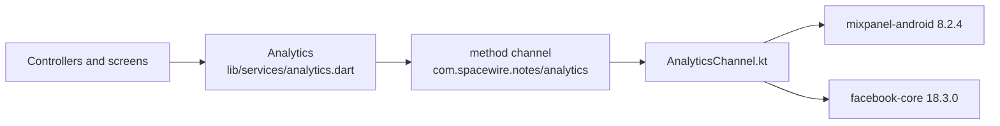

# Analytics

The app reports to two services: **Mixpanel** (every product event) and the **Facebook (Meta) SDK** (installs, app opens and the few events ads are measured on). This document lists every event, what triggers it and what it carries. Written from the code as of 2026-10-13. If you add, rename or remove an event, update this file in the same change.

**Neither service is configured yet.** The three keys are placeholders, so nothing is sent to anyone. See [Configuration](#configuration).

## How it is built

- [analytics.dart](../lib/services/analytics.dart) has one method per event, so the whole list is in one file. Nothing else builds an event name.
- The native SDKs are used directly from Kotlin over a method channel, the same way the install referrer is read, instead of through two Flutter plugins. The Kotlin is in [android/app/src/main/kotlin/com/spacewire/notes/analytics/](../android/app/src/main/kotlin/com/spacewire/notes/analytics/).
- Calls are fire-and-forget. Nothing waits for analytics, and a failure in it is swallowed: it can never stop a screen from working.
- **Android only.** On iOS every call is dropped before it leaves Dart.
- Event names are Title Case. Property names are snake_case.

## Configuration

All three keys are in [analytics_keys.xml](../android/app/src/main/res/values/analytics_keys.xml). They are public by design (they ship inside every APK), so the file is committed.

| Key | Where to get it |
|-----|-----------------|
| `mixpanel_token` | Mixpanel: Project settings, Project token |
| `facebook_app_id` | developers.facebook.com: the app, App settings, Basic |
| `facebook_client_token` | developers.facebook.com: the app, App settings, Advanced |

While a key is still its placeholder (`YOUR_MIXPANEL_TOKEN`, `YOUR_FACEBOOK_APP_ID`, `YOUR_FACEBOOK_CLIENT_TOKEN`), that SDK is never started. The Facebook SDK needs both of its keys. `AndroidManifest.xml` also sets `AutoInitEnabled` and `AutoLogAppEventsEnabled` to `false`, so an unconfigured build does not contact Facebook at all; [MetaSdk.kt](../android/app/src/main/kotlin/com/spacewire/notes/analytics/MetaSdk.kt) switches both back on once the keys are real.

Use a Mixpanel project and a Facebook app made for Notes. Do not paste in another app's keys: its events would be mixed with this app's.

A debug build prints every call to the Flutter console, tagged `[analytics]`, followed by `(NOT sent: the SDK has no key)` when the SDK is off.

The Facebook SDK adds the advertising-ID permission (`com.google.android.gms.permission.AD_ID`) and four `ACCESS_ADSERVICES_*` permissions to the app. Google Play asks about advertising-ID use when a build is uploaded, and the answer is now yes.

## Who an event belongs to

- **Before sign-in**, in either interface, events sit under an anonymous id that Mixpanel makes for the device.
- **At Google sign-in, and on every later app start with a live session**, the app identifies the person by their Firebase user ID. Mixpanel links the anonymous id to it, so the events from before sign-in join the same person.
- **When a phone sign-in code is verified** in the onboarding interface, the app identifies the person by their Supabase user ID. The phone number is never sent. Unlike the notes app, this is not repeated on later app starts.
- **At log out**, in either interface, Mixpanel is reset, so the next person to sign in on that phone starts clean.

The two interfaces use different account systems, so one human who uses both is two people in Mixpanel.

## Properties on every event

Set once as super properties.

| Property | Value |
|----------|-------|
| `platform` | `android` |
| `app_version` | The version name, for example `1.0.0` |
| `install_source` | `utm_source` of the Play Store link. `google-play` when found in the store, `google-ads` after an ad click, `unknown` when Play gave nothing |
| `install_medium` | `utm_medium` of the link. Otherwise `organic`, `cpc` (ad click), or `link` (a source was given but no medium) |
| `install_organic` | `true` when no link can take the credit |
| `install_campaign`, `install_content`, `install_term` | Only when the install link set them |

The `install_` properties appear once Google Play has answered where the install came from, which is during the first launch. Mixpanel's own automatic events (first open, app updated, session) are switched off.

## Mixpanel events

There are 29.

### Install and links

| Event | When it fires | Properties |
|-------|---------------|------------|
| `Install Attributed` | Once per install, on the first launch where Google Play answers where the install came from | The `install_` properties above |
| `Deep Link Opened` | An onboarding link reached the app: at launch, while running, or as the Play Store link the app was installed from | `target`: `onboarding`. `after_install`: `true` for the Play Store link. `started_onboarding`: `false` when the device was already in the flow, so the link changed nothing |
| `App Opened` | Every launch, before the first screen | none |

### Sign-in

| Event | When it fires | Properties |
|-------|---------------|------------|
| `Sign In Viewed` | The sign-in screen opens | none |
| `Sign In Started` | "Continue with Google" is tapped | none |
| `Sign In Succeeded` | Firebase accepted the Google account. The person is identified right after | `new_user`: `true` when this sign-in created the account |
| `Sign In Cancelled` | The Google sheet was dismissed. An unregistered signing certificate looks the same (see [05-setup-and-build.md](05-setup-and-build.md#sign-in-does-nothing-or-is-cancelled)) | none |
| `Sign In Failed` | Sign-in threw anything else | `reason` |
| `Signed Out` | Log out succeeded in the notes app, or "Log out" was tapped in the onboarding interface. Mixpanel is reset right after | none |

### Notes

None of these carry a note's title, body or ID.

| Event | When it fires | Properties |
|-------|---------------|------------|
| `Notes List Viewed` | The notes list opens | none |
| `Note Editor Opened` | The editor opens | `is_new`: `true` for a new note |
| `Note Created` | A new note is saved. An empty note is discarded and sends nothing | none |
| `Note Updated` | An existing note is saved | none |
| `Note Deleted` | A note is deleted, from the list or the editor | none |
| `Note Restored` | Undo is tapped after a delete | none |
| `Note Action Failed` | One of the four writes above was rejected | `action`: `create`, `update`, `delete`, `restore`. `reason` |
| `Profile Viewed` | The profile screen opens | none |

The four write events fire when the write is issued, not when the server confirms it, because offline that is not until the phone reconnects. A write that is later rejected sends both its own event and `Note Action Failed`.

### Onboarding

None of these carry the mobile number or the sign-in code.

| Event | When it fires | Properties |
|-------|---------------|------------|
| `Phone Entry Viewed` | The mobile-number screen opens, including on return from the code screen and after log out | none |
| `OTP Requested` | "Send code" or "Resend code" is tapped | `resend`: `true` from the code screen |
| `OTP Request Failed` | The code could not be sent | `reason` |
| `OTP Verified` | The server accepted the code. The person is identified just before | `new_user`: `true` when this number had no account |
| `OTP Verify Failed` | The code was refused, or the check could not be made | `reason` |
| `Paywall Viewed` | The paywall opens | none |
| `UPI App Selected` | A different UPI app is chosen in the sheet | `upi_app`: the app's public name, such as `PhonePe` |
| `Checkout Started` | "Try Now" is tapped with a UPI app chosen | `plan_id`, `upi_app` |
| `Subscription Succeeded` | The server confirmed the AutoPay mandate | `plan_id`, `amount`, `currency`, `simulated` |
| `Checkout Cancelled` | The person backed out of the UPI app | `plan_id` |
| `Checkout Failed` | The payment failed, was still unconfirmed when the app stopped waiting, or could not be started | `plan_id`, `reason` |
| `Maintenance Viewed` | The maintenance screen opens, including on every later launch | none |

- `plan_id` is the backend's `cashfree_plan_id`, or `monthly` when that row is blank.
- `amount` is what was authorised today, the trial price (₹3 by default), not the monthly price. Later monthly debits happen on the server and send no event from the app.
- `simulated` is `true` only in test mode, a debug build with no backend. Filter on `simulated` = `false` to count revenue.
- A person who taps "Try Now" but already has a subscription is let in with no `Subscription Succeeded`: nothing was bought.

### `reason` values

A `reason` is a short code, never the error's message, which is free text and can contain an email address. It comes from `errorCode` in [errors.dart](../lib/utils/errors.dart): the Firebase error code (`permission-denied`, `network-request-failed`), the Google sign-in code (`interrupted`, `clientConfigurationError`), the backend error kind (`network`, `wrongCode`, `tooManyRequests`, `signedOut`, `server`, `notConfigured`), the payment error kind (`declined`, `pending`, `upiAppUnavailable`, `unsupported`) or, for a decline, Cashfree's own code, or otherwise the name of the error's class (`StateError`).

## Profile properties

Set on the person, not on events.

| Property | When |
|----------|------|
| `$name`, `$email` | At Google sign-in and each app start with a session, from the Google account |
| `install_source`, `install_medium`, `install_organic`, `install_campaign`, `install_content`, `install_term` | Set once and never overwritten, so a reinstall keeps the first source |

A person identified by phone sign-in has a profile with the install properties only: no name, email or phone number is set.

## Facebook (Meta) events

| Event | When it fires | Parameters |
|-------|---------------|------------|
| App install, app open (automatic) | Sent by the SDK itself once it is configured | The SDK's own |
| `fb_mobile_complete_registration` | A Google sign-in, or a verified phone code, that created the account | `fb_registration_method`: `google`, `phone` |
| `fb_mobile_initiated_checkout` | "Try Now" is tapped with a UPI app chosen | `fb_content_id` (the plan), `fb_currency`, and the price as the value |
| `fb_mobile_purchase` and `Subscribe` | A **real** payment succeeded | `fb_content_id`, `fb_currency`, the price |

**A simulated payment sends no purchase to Facebook.** Its Purchase event carries revenue that ad delivery is optimised on, and a simulated payment is not revenue. A build with a Supabase project uses the Cashfree gateway, whose `isSimulated` is false, and sends both events with the trial price as the value.

## The funnels

Onboarding, for a person who installs from an onboarding Play Store link:

`Install Attributed` → `App Opened` → `Deep Link Opened` → `Phone Entry Viewed` → `OTP Requested` → `OTP Verified` → `Paywall Viewed` → `Checkout Started` → `Subscription Succeeded` → `Maintenance Viewed`

Notes, for a new user:

`Install Attributed` → `App Opened` → `Sign In Viewed` → `Sign In Started` → `Sign In Succeeded` → `Notes List Viewed` → `Note Editor Opened` → `Note Created`

## What has been checked

- **Nothing has been seen inside a Mixpanel project or in Facebook Events Manager**, because neither has keys yet.
- With placeholder keys (2026-10-13, test phone): the app starts, both SDKs report themselves disabled, and the Facebook SDK makes no network request.
- With throwaway dummy keys (2026-10-13, test phone), the earlier onboarding flow reached both SDKs. **The events were then changed** (the details-form events were replaced by the phone and code events) and that check has not been repeated: the current onboarding events are covered by widget tests in [analytics_test.dart](../test/analytics_test.dart) only.
- A real (not simulated) `Subscription Succeeded`, and Facebook's purchase events, have never been sent: no real payment has been made.
- **The six sign-in events, the eight notes events, `identify` and the reset on log out have never run**, on a phone or in a test. Google sign-in is blocked on the test phone ([07-known-issues.md](07-known-issues.md)), and the signed-in screens have no widget tests.

## Known gaps

- iOS sends nothing.
- Debug builds will report to the same Mixpanel project and Facebook app as released builds, so test runs will be mixed in with real users. In test mode (a debug build with no Supabase project) `OTP Verified` fires for the stand-in account `debug-user`, which every such phone then shares in Mixpanel.
- If Google Play cannot answer on the first launch, the app asks again on each later launch with no limit, and `Install Attributed` is sent whenever it first answers. A phone with no Play Store never sends it and never gets the `install_` properties.
- An install that happened before the Mixpanel token was set keeps its `install_` properties (they are stored on the phone), but its `Install Attributed` event is lost.
- Screen-view events fire when the screen is created. `Maintenance Viewed` therefore fires on every launch of a subscribed phone, and `Sign In Viewed` on every launch of a signed-out one. Count unique users, not totals.
- There is no event for a mobile number that fails validation, none for an error on the notes list, and none when a subscription lapses and the person is returned to the paywall.
- Renewals, failed debits and cancellations are known only to the server. CashAlert sends these to Mixpanel from its webhook; this backend does not.
- No consent screen. The Facebook SDK collects the advertising ID as soon as it is configured. Check what the markets the app ships to require before adding real keys.
