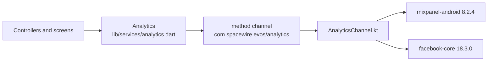

# Analytics

The app reports to two services: **Mixpanel** (every product event) and the **Facebook (Meta) SDK** (installs, app opens and the few events ads are measured on). This document lists every event, what triggers it and what it carries. Written from the code as of 2026-10-13. If you add, rename or remove an event, update this file in the same change.

**Both services are configured** (keys added 2026-10-21): Mixpanel project token and the Facebook app "evos" (`2015134735846694`). Debug and release builds report to the same project and app. See [Configuration](#configuration).

## How it is built

- [analytics.dart](../lib/services/analytics.dart) has one method per event, so the whole list is in one file. Nothing else builds an event name.
- The native SDKs are used directly from Kotlin over a method channel, the same way the install referrer is read, instead of through two Flutter plugins. The Kotlin is in [android/app/src/main/kotlin/com/spacewire/evos/analytics/](../android/app/src/main/kotlin/com/spacewire/evos/analytics/).
- Calls are fire-and-forget. Nothing waits for analytics, and a failure in it is swallowed: it can never stop a screen from working.
- **Android only.** On iOS every call is dropped before it leaves Dart.
- Event names are Title Case. Property names are snake_case.

## Configuration

All three keys are in [analytics_keys.xml](../android/app/src/main/res/values/analytics_keys.xml). They are public by design (they ship inside every APK), so the file is committed.

| Key | Where to get it |
|-----|-----------------|
| `mixpanel_token` | Mixpanel: Project settings, Project token |
| `facebook_app_id` | developers.facebook.com: the app, App settings, Basic |
| `facebook_client_token` | developers.facebook.com: the app, App settings, Advanced |

While a key is still its placeholder (`YOUR_MIXPANEL_TOKEN`, `YOUR_FACEBOOK_APP_ID`, `YOUR_FACEBOOK_CLIENT_TOKEN`), that SDK is never started. The Facebook SDK needs both of its keys. `AndroidManifest.xml` also sets `AutoInitEnabled` and `AutoLogAppEventsEnabled` to `false`, so an unconfigured build does not contact Facebook at all; [MetaSdk.kt](../android/app/src/main/kotlin/com/spacewire/evos/analytics/MetaSdk.kt) switches both back on once the keys are real.

Use a Mixpanel project and a Facebook app made for Notes. Do not paste in another app's keys: its events would be mixed with this app's.

To register the Android app in that Facebook app (App settings, Basic, Add platform, Android), give it:

| Field | Value |
|-------|-------|
| Package name | `com.spacewire.evos` |
| Class name | `com.spacewire.evos.MainActivity` |
| Key hash, release (upload key, `CN=Spacewire`) | `QkzkxxTG+N0r4LO1EhaGeMzA12A=` |
| Key hash, debug (this machine's debug keystore) | `ZxzUG7wUg2IIqMRyqMrtOtw72dM=` |

Both hashes were computed on 2026-10-21 from the signed APKs with `apksigner verify --print-certs` (SHA-1 in hex, converted to Base64). Once Play App Signing re-signs the app, also add the hash of Play's app signing key: take its SHA-1 from Play Console (Test and release, App integrity) and run `echo <SHA-1 without colons> | xxd -r -p | openssl base64`.

A debug build prints every call to the Flutter console, tagged `[analytics]`, followed by `(NOT sent: the SDK has no key)` when the SDK is off.

The Facebook SDK adds the advertising-ID permission (`com.google.android.gms.permission.AD_ID`) and four `ACCESS_ADSERVICES_*` permissions to the app. Google Play asks about advertising-ID use when a build is uploaded, and the answer is now yes.

## Who an event belongs to

- **Before sign-in**, events sit under an anonymous id that Mixpanel makes for the device.
- **When a phone sign-in code is verified**, the app identifies the person by their Supabase user ID. The phone number is never sent. This is not repeated on later app starts.
- **The review account (9931133385) is never identified.** It has no server or Firebase account, and every reviewer shares it; its events — including the notes events for its local notes — stay under the device's anonymous id.
- **At log out**, Mixpanel is reset, so the next person to sign in on that phone starts clean.

## Properties on every event

Set once as super properties.

| Property | Value |
|----------|-------|
| `platform` | `android` |
| `app_version` | The version name, for example `1.0.0` |
| `install_source` | `utm_source` of the Play Store link. `google-play` when found in the store, `google-ads` after an ad click, `unknown` when Play gave nothing |
| `install_medium` | `utm_medium` of the link. Otherwise `organic`, `cpc` (ad click), or `link` (a source was given but no medium) |
| `install_organic` | `true` when no link can take the credit |
| `install_campaign`, `install_content`, `install_term` | Only when the install link set them |

The `install_` properties appear once Google Play has answered where the install came from, which is during the first launch. Mixpanel's own automatic events (first open, app updated, session) are switched off.

## Mixpanel events

There are 26.

### Install and links

| Event | When it fires | Properties |
|-------|---------------|------------|
| `Install Attributed` | On the first launch where Google Play answers where the install came from. An empty answer is asked for again on up to 5 launches, and each asks sends the event again | The `install_` properties above. `install_referrer_raw`: Play's referrer exactly as received, cut to 100 characters (link parameters only). `referrer_click_recorded`: `false` when Play recorded no tap on a link. `referrer_attempt`: which launch asked, from 1 |
| `Deep Link Opened` | An onboarding link reached the app: at launch, while running, or as the Play Store link the app was installed from. Since 2026-10-22 a link changes nothing on screen; this is for attribution | `target`: `onboarding`. `after_install`: `true` for the Play Store link |
| `App Opened` | Every launch, before the first screen | none |

### Sign-out

| Event | When it fires | Properties |
|-------|---------------|------------|
| `Signed Out` | "Log out" was tapped on the web page screen (or, in the unreachable notes interface, log out succeeded). Mixpanel is reset right after | none |

### Notes

None of these carry a note's title, body or ID.

| Event | When it fires | Properties |
|-------|---------------|------------|
| `Notes List Viewed` | The notes list opens | none |
| `Note Editor Opened` | The editor opens | `is_new`: `true` for a new note |
| `Note Created` | A new note is saved. An empty note is discarded and sends nothing | none |
| `Note Updated` | An existing note is saved | none |
| `Note Deleted` | A note is deleted, from the list or the editor | none |
| `Note Restored` | Undo is tapped after a delete | none |
| `Note Action Failed` | One of the four writes above was rejected | `action`: `create`, `update`, `delete`, `restore`. `reason` |
| `Profile Viewed` | The profile screen opens | none |

The four write events fire when the write is issued, not when the server confirms it, because offline that is not until the phone reconnects. A write that is later rejected sends both its own event and `Note Action Failed`.

### Onboarding

None of these carry the mobile number or the sign-in code.

| Event | When it fires | Properties |
|-------|---------------|------------|
| `Phone Entry Viewed` | The mobile-number screen opens, including on return from the code screen and after log out | none |
| `OTP Requested` | "Send code" or "Resend code" is tapped | `resend`: `true` from the code screen. `country`: ISO code of the number's country, such as `IN` |
| `OTP Request Failed` | The code could not be sent | `reason` |
| `OTP Verified` | The server accepted the code. The person is identified just before | `new_user`: `true` when this number had no account |
| `OTP Verify Failed` | The code was refused, or the check could not be made | `reason` |
| `Review Account Signed In` | The review number 9931133385 was signed in with its fixed code, onto the local notes screen. Not identified, not a Meta registration | none |
| `Paywall Viewed` | The paywall opens | none |
| `UPI App Selected` | A different UPI app is chosen in the sheet | `upi_app`: the app's public name, such as `PhonePe` |
| `Checkout Started` | "Try Now" is tapped with a UPI app chosen | `plan_id`, `upi_app` |
| `Subscription Succeeded` | The server confirmed the AutoPay mandate | `plan_id`, `amount`, `currency`, `simulated` |
| `Checkout Cancelled` | The person backed out of the UPI app | `plan_id` |
| `Checkout Failed` | The payment failed, was still unconfirmed when the app stopped waiting, or could not be started | `plan_id`, `reason` |
| `Web Page Viewed` | The web page screen opens, including on every later launch | `has_url`: `false` when there is no `webview_url` and "You're all set" shows instead. `install_source`: the install's attributed source, when known (omitted otherwise). `web_host`: the host of the page loaded, when any (never the full URL). Together they show a misrouted source — on the wrong page, or on none — in Mixpanel |
| `Web Page Failed` | The page's main document failed to load (not a missing image or script) | `reason`: the WebView's error type, such as `hostLookup`, `timeout`, `connect`; `unknown` when it gives none. Never the URL |

- `plan_id` is the backend's `cashfree_plan_id`, or `monthly` when that row is blank.
- `amount` is what was authorised today, the trial price (₹3 by default), not the monthly price. Later monthly debits happen on the server and send no event from the app.
- `simulated` is `true` only in test mode, a debug build with no backend. Filter on `simulated` = `false` to count revenue.
- A person who taps "Try Now" but already has a subscription is let in with no `Subscription Succeeded`: nothing was bought.

### `reason` values

A `reason` is a short code, never the error's message, which is free text and can contain an email address. It comes from `errorCode` in [errors.dart](../lib/utils/errors.dart): the Firebase error code (`permission-denied`, `network-request-failed`), the backend's own failure code when it sends one (`cashfree_auth_failed`, `email_domain_missing` and the others listed in [09-deep-link-onboarding.md](09-deep-link-onboarding.md#payment)), otherwise the backend error kind (`network`, `wrongCode`, `tooManyRequests`, `countryNotSupported`, `signedOut`, `server`, `notConfigured`), the payment error kind (`declined`, `pending`, `upiAppUnavailable`, `unsupported`) or, for a decline, Cashfree's own code, or otherwise the name of the error's class (`StateError`).

## Profile properties

Set on the person, not on events.

| Property | When |
|----------|------|
| `install_source`, `install_medium`, `install_organic`, `install_campaign`, `install_content`, `install_term` | Set once and never overwritten, so a reinstall keeps the first source |

A person identified by phone sign-in has a profile with the install properties only: no name, email or phone number is set.

## Facebook (Meta) events

| Event | When it fires | Parameters |
|-------|---------------|------------|
| App install, app open (automatic) | Sent by the SDK itself once it is configured | The SDK's own |
| `fb_mobile_complete_registration` | A verified phone code that created the account | `fb_registration_method`: `phone` |
| `fb_mobile_initiated_checkout` | "Try Now" is tapped with a UPI app chosen | `fb_content_id` (the plan), `fb_currency`, and the price as the value |
| `fb_mobile_purchase` and `Subscribe` | A **real** payment succeeded | `fb_content_id`, `fb_currency`, the price |

**A simulated payment sends no purchase to Facebook.** Its Purchase event carries revenue that ad delivery is optimised on, and a simulated payment is not revenue. A build with a Supabase project uses the Cashfree gateway, whose `isSimulated` is false, and sends both events with the trial price as the value.

## The funnels

Every new user:

`Install Attributed` → `App Opened` → `Phone Entry Viewed` → `OTP Requested` → `OTP Verified` → `Paywall Viewed` → `Checkout Started` → `Subscription Succeeded` → `Web Page Viewed`

`Deep Link Opened` comes after `App Opened` when the install came from an onboarding link. Filter out `Review Account Signed In` sessions to keep store reviewers out of the funnel.

## What has been checked

- **With the real keys (2026-10-21, test phone, test-mode debug build), both services accepted every event sent.** Checked in logcat, not inside Mixpanel or Events Manager:
  - Facebook confirmed the App ID and client token belong together (a Graph API read answered with the app name "evos").
  - Mixpanel: `App Opened`, `Install Attributed`, `Deep Link Opened`, `Phone Entry Viewed`, `OTP Requested`, `OTP Verified`, `Paywall Viewed`, `Checkout Started`, `Subscription Succeeded` (`simulated: true`), `Maintenance Viewed` (since replaced by `Web Page Viewed`), `Signed Out`, and the `identify` profile update. `/track` and `/engage` both answered `status: 1`.
  - Facebook: `fb_sdk_initialize`, `MOBILE_APP_INSTALL` (first launch after clearing data), `fb_mobile_activate_app` and `fb_mobile_initiated_checkout`, each answered `success: true`. `metaSubscribe` was correctly skipped for the simulated payment. `metaCompleteRegistration` did not fire, because test mode's `debug-user` is never a new user.
  - On the first launch after install the SDK logs `GraphRequest can't be used when Facebook SDK isn't fully initialized` about five times (see [05-setup-and-build.md](05-setup-and-build.md#logcat-errors-that-are-expected)). Harmless: the same launch then fetched the SDK settings and sent the install.
- Debug builds log every Facebook request and App Events flush (tags `FacebookSDK.Request`, `FacebookSDK.Response`, `FacebookSDK.AppEvents`), as they already did for Mixpanel (`MixpanelAPI.*`). Logcat cuts long lines at about 4 KB, so a Mixpanel batch's event list looks truncated; the `raw size` line shows the whole batch went.
- Events still queued when the app is killed are kept on the device and sent on the next launch. Maestro's `clearState` deletes them, so a flow that ends with it loses its last minute of events.
- With throwaway dummy keys (2026-10-13, test phone), the earlier onboarding flow reached both SDKs. **The events were then changed** (the details-form events were replaced by the phone and code events) and that check has not been repeated: the current onboarding events are covered by widget tests in [analytics_test.dart](../test/analytics_test.dart) only.
- A real (not simulated) `Subscription Succeeded`, and Facebook's purchase events, have never been sent: no real payment has been made.
- **`Web Page Viewed`, `Web Page Failed` and `Review Account Signed In` (2026-10-22) have not run on a phone.** The first and last are covered by widget tests; `Web Page Failed` needs a real WebView.
- **The notes events run only for the review account's local notes** (anonymous id). They have not been checked on a phone.

## Known gaps

- iOS sends nothing.
- Debug builds will report to the same Mixpanel project and Facebook app as released builds, so test runs will be mixed in with real users. In test mode (a debug build with no Supabase project) `OTP Verified` fires for the stand-in account `debug-user`, which every such phone then shares in Mixpanel.
- If Google Play cannot answer on the first launch, the app asks again on each later launch with no limit, and `Install Attributed` is sent whenever it first answers. If Play answers with an empty referrer, the app asks again on up to 5 launches in all, sending `Install Attributed` each time. A phone with no Play Store never sends it and never gets the `install_` properties.
- An install that happened before the Mixpanel token was set keeps its `install_` properties (they are stored on the phone), but its `Install Attributed` event is lost.
- Screen-view events fire when the screen is created. `Web Page Viewed` therefore fires on every launch of a subscribed phone, and `Phone Entry Viewed` on every launch of a signed-out one. Count unique users, not totals.
- There is no event for a mobile number that fails validation, none for an error on the notes list, and none when a subscription lapses and the person is returned to the paywall.
- Renewals, failed debits and cancellations are known only to the server. CashAlert sends these to Mixpanel from its webhook; this backend does not.
- No consent screen. The Facebook SDK collects the advertising ID as soon as it is configured. Check what the markets the app ships to require before adding real keys.
